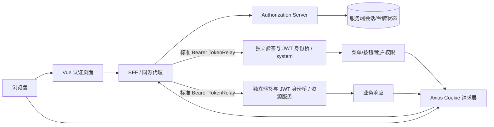
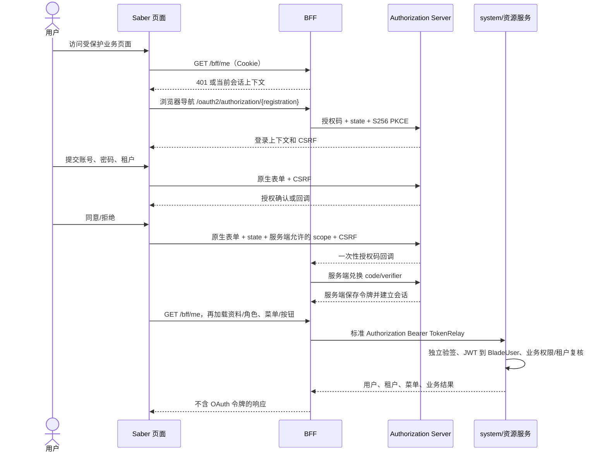

# Saber 新认证服务与 BFF 前端适配详细设计文档

## 1. 文档信息

| 项目 | 内容 |
| --- | --- |
| 功能/模块 | 新认证服务与 BFF 前端适配 |
| 设计编号 | DESIGN-REQ-2026-015 |
| 文档版本 | 0.11 |
| 关联需求 | [REQ-2026-015](../requirements/REQ-2026-015-authorization-frontend-adaptation.md) |
| 目标版本/迭代 | Saber 5.x / SpringBlade 新 OAuth2/OIDC 与 BFF 迁移第一阶段 |
| 文档状态 | 开发中（登录与确权界面改版，新增验收待执行；历史阶段结果保留） |
| 设计负责人 | Codex |
| 评审人 | 产品、前端、后端、网关、安全、测试：待指定 |
| 最后更新日期 | 2026-10-15 |
| 实施前后端评估基线 | SpringBlade REQ-2026-010 0.13、DESIGN 0.12、DB 0.9、TEST 0.13（2026-10-13）及当前工作区 |
| 数据库 / 测试文档 | Saber数据库不涉及；[前端测试文档0.9](../test/TEST-REQ-2026-015-authorization-frontend-adaptation.md)：新增界面与恢复流程验收待执行；历史阶段证据保留 |

## 2. 设计摘要与范围

### 2.1 设计摘要

Saber 浏览器只通过同源 BFF 会话 Cookie 访问认证和业务资源。OAuth2/OIDC 授权码、PKCE、令牌兑换、刷新与撤销全部由 BFF 和 Authorization Server 完成，前端不读取、保存、刷新或拼接 Access Token、Refresh Token、BFF/服务认证密钥或旧 Basic 凭据。管理员可在当前表单短暂输入客户端新原始密钥并显式保存，此值不持久化、不回显、不用作浏览器凭据。

前端新增认证页面适配层，负责登录上下文、授权确认、回调错误和会话状态；请求层改为 Cookie 会话并按后端契约处理 CSRF；现有动态菜单、按钮权限、租户数据权限和业务页面继续消费后端结果。OAuth 客户端管理沿用现有分页 CRUD 外壳，仅调整字段白名单、PKCE/回调校验、密钥写入语义和停用状态。

本设计以 REQ-2026-015 0.7 和 [SpringBlade 新认证设计 0.12](../../../SpringBlade/doc/design/DESIGN-REQ-2026-010-production-authentication.md)为边界。其 13.4 已明确前端实施契约；最新后端源码还具备 roles、AUTH CSRF、JSON 改密、稳定 401 码、新注册、单会话串行授权及生产代理。前端可以据此实施；实际接口视图、并发、生产环境和全站验收仍待完成，注册配置字节上限字段仍有文档/源码差距。

### 2.2 关键决策

| 编号 | 决策 | 原因 | 影响 |
| --- | --- | --- | --- |
| DEC-001 | 浏览器认证和业务请求统一使用同源 HttpOnly 会话 Cookie | 防止令牌进入 JavaScript、Storage、日志和 URL | 移除旧 Token Store、`Authorization` 拼接和客户端密钥配置 |
| DEC-002 | 登录和授权决定使用认证服务原生表单导航提交 | 密码和一次性授权上下文不进入 Axios 响应、Pinia 或业务日志 | 后端 AUTH 检查已具备；前端登录/approve/deny 均带对应上下文 CSRF，保留提交锁和错误回跳 |
| DEC-003 | BFF 与认证服务 CSRF 分别维护，内存单飞获取；写失败不自动重放 | 两个服务独立会话，403 也可能是 scope/业务权限拒绝 | 非AUTH请求403使BFF校验缓存失效，下次用户主动提交重新获取；不猜拒绝原因 |
| DEC-004 | BFF 会话身份与现有菜单/按钮权限通过适配层衔接 | OAuth scope 只控制协议资源，不能替代业务权限和租户校验 | `useUserStore` 保留业务权限 API，移除令牌字段 |
| DEC-005 | 客户端编辑留空密钥表示保留原值 | 原始密钥不回显，空字符串不能触发误轮换 | 表单提交前按字段白名单构造 payload |
| DEC-006 | 新系统上线后不保留旧认证兼容或自动回退 | 需求明确唯一认证链路，避免双 Cookie、双 Store 和旧入口复活 | 前端单独回滚需新契约兼容版本；首次整体恢复边界见 10.2 |
| DEC-007 | BFF 到下游只用标准 Bearer + 资源服务 JWT/BladeUser 桥 | 后端已取消 IDENTITY、HMAC 和旧共享身份凭据 | 前端无模式开关，不传播 Token 或自定义身份头 |
| DEC-008 | `/bff/me` 只向前端返回摘要，不生成完整 UserInfo 或管理员身份 | 摘要没有 tenant/roles/authority，scope 不能替代角色 | 独立加载已具备 roles 的 system 资料；实际视图或初始化失败时阻止依赖入口 |
| DEC-009 | 客户端原始新密钥只在管理员表单及显式保存请求体中短暂存在 | 后端为 write-only、自备原始密钥、单值替换 | 不新增生成、一次展示、版本列表或双密钥过渡接口 |

### 2.3 改动范围

| 层级 | 改动内容 | 不涉及内容 |
| --- | --- | --- |
| 后端 | 不修改 Saber 后端；依赖 SpringBlade 提供 Authorization Server、BFF、会话、CSRF、用户上下文和业务路由 | 认证服务实现、JWT/JWK、Redis/MySQL、Token 签发与刷新、资源服务验签 |
| 前端 | 认证页面、认证 API 适配、Axios 请求层、用户会话与路由守卫、动态菜单外链、客户端管理表单、错误反馈和权限初始化 | 重设计角色/菜单/按钮/租户模型；业务页面字段规则 |
| 数据库 | 不涉及 Saber 数据库 | SpringBlade 授权状态、客户端、会话和同意数据表 |
| 配置/部署 | 开发代理、生产同源反向代理、HTTPS、Cookie、CSRF 和精确回调地址说明 | 本地密钥、客户端原始密钥、生产专用地址和 Secret 不进入仓库 |

## 3. 总体设计

### 3.1 架构图

浏览器与认证服务、BFF 使用部署约定的同源路径。开发环境由 Vite 代理转发，生产环境由反向代理提供同源入口；前端不根据请求 Host 推导 issuer，不直接访问 OAuth 协议令牌端点。

### 3.2 组件职责

| 组件 | 职责 | 输入 | 输出 |
| --- | --- | --- | --- |
| `src/page/auth/*` | 展示登录上下文、授权范围、错误和重试状态；承接原生表单导航 | 路由查询、认证上下文、用户输入 | 认证服务导航或固定错误入口 |
| `src/api/authorization.ts` | 定义认证上下文、BFF 摘要、CSRF 和退出的最小类型；统一使用`@/axios` | 同源 Cookie、客户端/状态参数 | 页面所需的非敏感上下文和状态码 |
| `src/axios.ts` | 统一业务请求、Cookie、CSRF 元数据、401/403/429/5xx 处理 | 业务 API 请求 | 业务响应或统一错误 |
| `useAuthSession` | 单飞检查会话及初始化、按会话代次丢弃旧响应、清理动态路由/UI | Router、Pinia、BFF `/me`、system 资料/角色 | `unknown/checking/initializing/ready/anonymous/unavailable` 状态 |
| `src/store/user.ts` | 保存当前用户、角色、菜单和按钮权限的 UI 状态 | BFF 用户上下文、现有菜单 API | 权限判断和动态路由输入 |
| `src/permission.ts` | 保护业务路由、恢复安全回跳位置、处理一次性 401 跳转 | Router、会话状态 | 允许进入、登录跳转或 403 |
| `src/router/dynamic-router.ts` / `menu.ts` | 根据后端菜单装配页面，禁止把 Token 注入 iframe/外链 URL | 菜单树、页面模块 | 动态路由和同源外链 |
| `src/views/system/client.vue` | OAuth 客户端列表、详情、新增、编辑、删除/停用 | 客户端 API、管理员权限 | 白名单字段的写请求和状态反馈 |
| Vite/反向代理 | 提供 `/auth-api`、`/bff`、OAuth 回调和业务 API 的同源转发 | 环境配置 | 同源响应、Cookie 和回调路径 |

### 3.3 新增依赖

不适用。继续使用 Vue 3、Pinia、Axios、Vue Router、Element Plus 和现有工具，不引入 OAuth SDK、Token 存储库或第二套 HTTP 客户端。

## 4. 核心流程设计

### 4.1 技术流程图

### 4.2 异常与边界流程

| 场景 | 处理位置 | 处理方式 | HTTP/错误码 | 数据是否改变 |
| --- | --- | --- | --- | :---: |
| 未登录或会话不存在 | Axios/路由守卫 | 清理本地用户、菜单、标签和锁屏状态；保存安全的同源回跳位置；只跳转一次新认证入口 | 401 | 否 |
| 登录凭据、用户或租户无效 | 认证页面 | 清空密码，保留租户/账号等非敏感输入和重试入口，不回显内部原因 | 后端定义的 4xx | 否 |
| state、PKCE、回调或授权码无效 | 认证页面/BFF | 清空上下文，不显示敏感参数，回到固定认证入口 | 400/401 | 否 |
| scope、按钮或租户权限不足 | 业务请求/页面 | 保留会话和表单，显示 403/业务错误，不伪造成功或菜单 | 403 | 否 |
| CSRF 缺失、过期或错误 | 写请求包装器 | 禁止提交或显示失败；刷新 CSRF 后只允许用户重新触发 | 403 | 否 |
| BFF 刷新失败或会话撤销 | Axios 401 处理 | 清理本地状态并跳转登录，不重放旧 Token 或无限重试 | 401 | 否 |
| 认证依赖超时/5xx/429 | API 页面 | 保留可重试上下文，不把未知状态当作已登录、空权限或成功 | 429/5xx | 否 |
| 客户端编辑密钥留空 | 客户端表单 | 从 payload 省略密钥字段，服务端保留原密钥 | 2xx | 其他字段改变 |

### 4.3 事务、并发与幂等

| 操作 | 事务边界 | 并发控制 | 幂等策略 |
| --- | --- | --- | --- |
| 登录/授权确认 | 由 Authorization Server 负责一次性授权状态和令牌事务 | 前端只允许一个表单提交；后端校验 state/PKCE 一次性使用 | 重复回调视为无效并重新发起登录 |
| BFF 会话检查 | GET `/bff/me`；前端 `useAuthSession` 单飞 | 相同会话代次复用检查；当前后端调用授权管理器，可刷新令牌 | 不写业务数据，但可能更新服务端协议状态；不重放原业务操作 |
| 获取 CSRF | BFF `/bff/csrf`；内存缓存到会话变化或非AUTH请求403 | 同时请求共享 Promise；读取 CSRF 自身绕过写注入以免递归 | 下次用户主动提交重新获取，不推断拒绝原因、不自动重放 |
| 业务写请求 | 由后端业务事务负责 | 页面提交按钮锁、行操作锁和上传锁分别维护 | 前端不伪造回滚；失败释放锁并保留输入 |
| 退出当前会话 | BFF `/bff/logout` | 单飞提交；完成后清理本地状态 | 服务端按会话幂等；网络不确定时不显示成功 |
| 客户端新增/编辑/停用/删除 | 由 system API 本地事务负责 | 前端请求锁；活动 clientId 唯一键已存在，后端无乐观版本锁 | 管理并发可能覆盖；结果不确定时重新查询，不宣称回滚 |

BFF 当前使用 `SessionSerialAuthorizedClientManager` 在单实例内按会话串行授权，`BffSessionAuthorizedClientRepository` 在授权前从 Redis 重读、保存后立即持久化；`/bff/me` 与 TokenRelay 共用该管理器。原“没有串行刷新实现”判断已过时。该实现不等于多实例协调或真实并发验收通过；前端保持普通业务并行语义、按来源处理 401，不申请令牌、不串行化全站请求、不重放写操作，真实并发回归归 ITEM-011。

## 5. 后端设计

### 5.1 路由、模型与服务

Saber 只实现前端适配，不新增后端路由。现有源码事实与目标设计0.12分开列出；未完成的全服务验收和目标扩展单独列为开放问题。

| 项目 | 设计 |
| --- | --- |
| 认证入口 | BFF 提供 `/oauth2/authorization/{registration}` 浏览器导航；Authorization Server 提供登录、同意和回调页面上下文 |
| 会话 | BFF HttpOnly Cookie；前端通过 `/bff/me` 查询，不读取服务端令牌 |
| 请求模型 | 登录、同意使用原生表单；BFF 写请求使用 `headerName/token`；认证服务登录使用独立 `parameterName/headerName/token`，登录和同意均消费独立AUTH CSRF |
| 响应模型 | 页面上下文、会话、业务响应均不包含 Access Token、Refresh Token、客户端原始密钥或堆栈 |
| 服务函数 | BFF 负责授权码兑换、刷新、下游 TokenRelay 和资源路由；前端只消费结果 |
| 业务 API | 七类固定 `/blade-*` 前缀经 BFF 转发并 StripPrefix(1)；当前未按方法收窄，逐 API/服务可用性仍待验收 |

### 5.2 认证与数据归属

- 是否需要登录：登录上下文和 OIDC discovery 不需要；授权确认、BFF 会话、业务 API 和客户端管理需要。
- 会话归属：用户/浏览器会话级，由 BFF 服务端维护 Cookie 会话 ID。
- 业务归属：system/资源服务独立验证标准 JWT，再由统一桥恢复 BladeUser；不读取网关自定义身份头。固定路由删除 Cookie 和 `X-User-Id/X-Tenant-Id/X-User-Roles` 后转发。
- 客户端写入：前端不得提交或覆盖 `tenant_id`、服务端用户 ID、授权上下文和会话 ID；租户只作为登录上下文输入，由服务端校验。
- OAuth scope：只作为协议资源边界，不能替代 `useCrudPermission`、角色、菜单、按钮或租户数据权限。
- 角色权限：沿用 `client_view`、`client_add`、`client_edit`、`client_delete` 等现有编码，后端仍是最终安全边界。

### 5.3 查询、归档与错误

- `/bff/me`、`/bff/csrf`、登录/同意上下文和退出响应使用 `Cache-Control: no-store`；前端不持久化认证上下文，不宣称全部普通业务写响应已由后端设置 no-store。
- 认证失败、资源不存在、权限不足和依赖失败保持 401/403/404/429/5xx 区分，前端只展示通用可恢复提示。
- 客户端列表默认只返回当前后端允许展示的字段；原始 `clientSecret` 永不返回。详情中的密钥输入框只用于新增或轮换，编辑空值表示省略字段。
- 业务列表、详情和删除沿用当前响应中的 `records/total`、详情对象和逗号分隔 `ids` 约定，最终以 BFF 代理后的业务接口为准。
- 禁止对外字段：密码、Access Token、Refresh Token、客户端原始密钥、JWK 私钥、数据库连接串、SQL、堆栈和完整请求体。

## 6. API 契约

### 6.1 接口清单

| 方法 | 路径 | 用途 | 访问条件 | 变更类型 |
| --- | --- | --- | --- | --- |
| GET | `/oauth2/authorization/{registration}` | 发起 BFF 授权码 + PKCE 流程 | 浏览器导航 | 新认证入口 |
| GET | `/auth-api/ui/login-context` | 获取登录上下文和认证服务 CSRF | 授权服务公开会话入口 | 当前 POC 已有 |
| POST | `/auth-api/login` | 原生表单提交登录 | 登录上下文有效 | 新增页面适配 |
| GET | `/auth-api/ui/consent` | 获取服务端确认的客户端和 scope | 当前授权会话 | 新增页面适配 |
| POST | `/auth-api/oauth2/authorize` | 提交同意或拒绝 | 当前授权会话 + state；独立AUTH CSRF已接入，运行待验收 | 已有协议入口，存在设计差距 |
| GET | `/bff/me` | 恢复当前 BFF 会话/用户上下文 | BFF Cookie | 新增 BFF 适配 |
| GET | `/bff/csrf` | 获取当前写请求 CSRF | 公开入口，按需建立当前 BFF Cookie 上下文 | 当前 POC 已有，不证明登录 |
| POST | `/bff/logout` | 退出当前 BFF 会话 | BFF Cookie + CSRF | 新增 BFF 适配 |
| GET | `/blade-system/user/register/config`、`/blade-system/user/register/captcha` | 注册规则/验证码 | 匿名；精确代理 | 新目标接口 |
| POST | `/blade-system/user/register` | 新注册 | 匿名+BFF CSRF；真实密码JSON | 新目标接口 |
| POST | `/blade-system/user/update-password` | 修改密码 | 当前用户+BFF CSRF；UserPasswordUpdateDTO | 改造目标 |
| GET | `/blade-system/user/info` | 当前用户资料 | Cookie TokenRelay + service.read + 有效用户主体 | 复用已有 API，实际输出字段需联调冻结 |
| GET | `/blade-system/menu/routes`、`/blade-system/menu/top-menu`、`/blade-system/menu/buttons` | 动态菜单、顶级菜单、按钮权限 | 当前用户及业务权限 | 既有 API，初始化改为显式等待 |
| GET | `/blade-system/client/list` | 分页查询 OAuth 客户端 | `client_view` | 既有 API 迁移到 BFF |
| GET | `/blade-system/client/detail` | 查询客户端详情 | `client_view` | 既有 API 迁移到 BFF |
| POST | `/blade-system/client/submit` | 新增/编辑客户端 | `client_add`/`client_edit` + CSRF | 字段契约调整 |
| POST | `/blade-system/client/remove` | 逻辑删除客户端 | `client_delete` + CSRF；后端 admin | 沿用 query ids；停用用 submit 的 status=0 |

`/oauth2/token`、`/oauth2/introspect`、`/oauth2/revoke` 不列为前端 API；它们只能由受信 BFF/服务客户端调用。`/auth-api/*` 是当前 POC 使用的同源前缀，若后端冻结其他前缀，只修改适配层和代理映射，不扩散到业务页面。

### 6.1.1 同源代理与路由边界

| 浏览器路径 | 转发路径/处理 | 当前事实及目标 |
| --- | --- | --- |
| `/auth/login`、`/auth/consent`、`/auth/verify` | Vue 页面 | 不转发到授权服务；验证页为联调入口，不证明业务迁移 |
| `/auth-api/*` | 授权服务去除 `/auth-api` | 当前 Vite 已有；必须保留 AUTH_SESSION，与 BFF 会话隔离 |
| `/oauth2/authorization/blade`、`/login/oauth2/code/blade`、`/bff/*` | BFF 原路径 | 当前 Vite 已有；浏览器导航承接授权/回调，不由 Axios 消费 302 |
| `/api/blade-system/**`、`/api/blade-desk/**`、`/api/blade-ai/**`、`/api/blade-log/**`、`/api/blade-resource/**`、`/api/blade-develop/**`、`/api/blade-report/**` | 新 BFF 去除 `/api`，再由固定路由去除服务前缀 | 复用当前业务逻辑 URL；开发 `/api` 的目标必须指向新 BFF，生产外层代理须显式配置 |
| `/blade-auth/**`、`/user/getUserInfo`、`/user/send-logs`、其他未登记路径 | 无固定新业务路由 | 不沿用旧发现路由作为兜底；逐调用方移除或确认真实替代契约 |
| 外部访问 `/feign/client` 及变体 | 网关规范化并拒绝 | 前端不直接调用内部用户认证/客户端接口 |

网关当前默认关闭 Nacos 动态路由，七类资源目标由固定 URL 配置提供；`GATEWAY_LEGACY_ROUTING_ENABLED` 只影响框架/发现路由，不能作为鉴权模式或回滚开关。授权服务/system 仍使用 Nacos Config/Discovery，这与网关固定路由不矛盾。

### 6.2 接口详细定义

#### `GET /bff/me`

- 用途：检查当前 BFF OIDC 主体及授权客户端是否存在，只返回会话摘要。
- 参数：无；凭据仅来自 HttpOnly Cookie。
- 成功响应：HTTP `200`，`R<BffSession>` 的 `data` 为 `{ subject, issuer, clientId, scope: string[], accessTokenExpiresAt }`。没有 `authenticated`、`tenantId`、头像、角色或按钮字段，不得按这些字段直接映射现有 UserInfo。
- 未登录：`401`，不返回其他用户信息。
- `accessTokenExpiresAt` 仅为摘要；前端不据其时间判定会话过期、启动 Token 刷新或计算按钮权限，BFF 可能在下游请求时正常刷新。
- 依赖失败：按实际 HTTP/业务错误处理；前端保持不可用状态并允许重试，不承诺所有依赖错误均为 503。
- 请求边界：当前后端通过授权管理器检查/刷新授权客户端，可能轮换服务端令牌，不只读取已保存的到期时间。前端同一导航/会话代次单飞，不用定时轮询替代后端刷新；不把服务端正常刷新视为会话失效。
- 兼容性：摘要已明确；用户/租户/角色和权限初始化见 7.2.1，角色编码来源仍为 ITEM-002。

#### `GET /bff/csrf` 与 `POST /bff/logout`

- `GET /bff/csrf` 返回 `R<{ headerName, token }>`；公开且可创建会话，不等于已登录。无 CSRF 配置时可能返回业务失败而非固定 HTTP 503；必须同时校验 HTTP、success/code、必填字段，响应 no-store，前端只存于内存。
- `POST /bff/logout` 不接受客户端提交的会话 ID、令牌或用户 ID，仅接受 Cookie 和 CSRF header；成功后前端清空 Pinia、标签、锁屏、临时表单和 CSRF 内存。
- CSRF 获取失败、403 或网络中断时不得显示“已退出”；显示可重试提示并允许重新检查 `/bff/me`。
- 退出只影响当前 BFF 会话。AUTH_SESSION 不清理，再次授权可能免密码；另一浏览器会话不受影响，不能承诺强制重新输密码或全局退出。已签发离线 JWT 在 exp 前可能仍有效。

#### 认证页面上下文和原生表单

- `GET /auth-api/ui/login-context`：返回待恢复授权状态、默认租户和当前 CSRF 参数；密码不在 URL、响应或日志中。
- `POST /auth-api/login`：只由原生表单提交 `tenantId/username/password` 和认证服务 CSRF 参数；提交真实密码，不调用旧 SM2/固定摘要登录包装器。前端不读取密码响应，不重放上次提交；不改动其他尚未确认的密码写入口。
- `GET /auth-api/ui/consent?client_id={id}&state={state}`：只展示服务端确认的 client、账号和 scope；不信任 URL 中自行追加的 scope。
- `POST /auth-api/oauth2/authorize`：提交 `client_id/state/decision` 及 approve 时重复的 `scope` 字段；`autoApproved` 项不另行申请，deny 不提交 scope。服务端校验当前主体与待确认授权，拒绝可能清理已有同意，不描述为绝无协议状态副作用。

- 当前后端 `ConsentContext.csrf:{parameterName,headerName,token}`、AUTH CookieCsrfTokenRepository 及位于授权端点前的 POST authorize CsrfFilter 已具备。前端 approve/deny 必须填入当前上下文的 AUTH 参数；目前认证类型和同意/拒绝原生表单已经消费该字段，提交前重新读取上下文；403 不签发 code/不消费同意状态仍需真实用例取证。
- BFF CookieServerCsrfTokenRepository 使用 BFF-XSRF-TOKEN/X-BFF-XSRF-TOKEN；SAS 使用 AUTH-XSRF-TOKEN/X-AUTH-XSRF-TOKEN。前端用JSON上下文中的headerName/token，不自动读默认XSRF Cookie。Token仅内存、按会话代次隔离，登录/退出/失效重新获取；生产Cookie Path=/、SameSite=Lax、Secure=true，会话HttpOnly。

- 认证错误：固定错误页或路由查询标记仅使用有限枚举（如 `credentials`、`csrf`、`service`、`authorization`），不回显 code、state、verifier、密码或内部异常。

#### OAuth 客户端管理

- `GET /blade-system/client/list`：查询参数仅允许 `current`、`size`、`clientId` 等后端白名单字段；响应使用 `records/total`。
- `GET /blade-system/client/detail`：按服务端 ID 查询；失败清空旧详情，禁止使用上一条详情提交。
- `POST /blade-system/client/submit`：新增和编辑共用时，编辑不得修改 `clientId`；`clientSecret` 为空时从请求体省略，非空时仅作为新密钥写入/轮换。
- `POST /blade-system/client/remove`：query `ids` 为确认后的逗号分隔 ID，执行逻辑删除；停用通过 `/submit` 的 `status=0`，无独立停用/轮换端点。空选择不发请求；成功刷新并清空选择，失败保留选择。
- 表单白名单包括客户端名称、认证方式、授权类型、scope、audience、精确回调地址、访问/刷新 TTL、PKCE、同意和状态；不允许提交 UI 临时字段、服务端归属字段或原始查询对象。

#### 6.2.1 客户端字段与校验基线

| 字段 | 当前后端规则 | 前端目标 |
| --- | --- | --- |
| `id/clientId/clientName` | 实例级；ID 格式 `[A-Za-z0-9._-]{1,48}`，名称非空且最多 100 字符；保留 bootstrap ID 禁止创建；编辑不可改 clientId | 新增校验格式；编辑锁定 clientId；不提交租户和实体审计字段 |
| `clientAuthenticationMethods/grantTypes` | 仅 `none` 或 `client_secret_basic`；仅 authorization_code/refresh_token/client_credentials；refresh_token 必须与授权码同时配置，none 只允许授权码 | 枚举控件及联动校验，不允许 client_secret_post；逗号分隔字符串提交 |
| `scopes/audiences/redirectUris` | scope/audience 非空，scope 为合法 OAuth ASCII 值；回调为精确 HTTPS 或回环 HTTP，无通配、userinfo 或 fragment | 按后端当前规则去空/去重和校验；不得自行添加 audience 枚举或动态 resource 参数协议 |
| `accessTokenTtl/refreshTokenTtl` | 默认 300/1800 秒，分别范围 1~86400、1~2592000 | 表单定义完整上下限并校验整数，不仅设最小值 |
| `requireProofKey/reuseRefreshTokens` | 授权码强制 PKCE；刷新重用必须 false | 授权码模式固定 true，reuseRefreshTokens 固定 false |
| `requireAuthorizationConsent/status` | 同意默认 true；status 只允许 0/1 | 保留布尔与数值类型，停用确认；不承诺旧 JWT 立即失效 |
| `clientSecret` | write-only；原始新值至少 16 字符、至多 72 UTF-8 字节，禁止 `{` 开头；合规旧值留空保留，公共客户端清空 | 机密编辑空值省略字段；变更为公共客户端由后端清空；显式换值需确认，不回显摘要/旧值 |

保存白名单为 `id`（仅编辑）、`clientId/clientName/clientAuthenticationMethods/grantTypes/scopes/audiences/redirectUris/accessTokenTtl/refreshTokenTtl/requireProofKey/requireAuthorizationConsent/reuseRefreshTokens/status`，必要时加入新 `clientSecret`。当前页面已经按白名单构造payload，编辑空密钥省略字段。后端允许合规旧密钥编辑空值，不代表任意旧摘要可永久保留。

后端 AuthClientController 的类级 admin 校验与前端 `client_*` 按钮权限共同约束入口；不能把有按钮权限等同于管理员。没有密钥版本、乐观锁或自动回滚；管理并发覆盖、单值替换后的调用方更新由后端/运维验收，不在 Saber 新建轮换平台。

### 6.3 列表接口

- 分页格式：`current`、`size` 查询参数；服务端返回 `data.records` 与 `data.total`，由 `usePagedList` 管理。
- 默认排序：以后端稳定排序为准；前端不伪造总数，必要时以 `id` 作为稳定次级排序。
- 允许筛选：当前仅客户端 ID 等已确认白名单字段；不得透传任意查询键。
- 归档数据：客户端禁用/删除状态由后端规则决定；前端不把停用项当作可授权客户端，也不自行恢复逻辑删除数据。

## 7. 前端设计

### 7.1 页面与组件

| 页面/组件 | 类型 | 职责 | 访问条件 |
| --- | --- | --- | --- |
| `/auth/register` | 注册页面 | system新接口、BFF CSRF、成功回新登录 | 未登录且注册开启 |
| `/auth/login` | 品牌分栏登录页 | 自动准备授权，组织/账号/密码原生提交；注册成功主动登录，退出落地停止自动SSO | 未登录、会话失效或退出后 |
| `/auth/consent` | 独立确权卡片 | 服务端账号、应用、全部权限说明与可展开标识；授权并登录/取消登录原生提交 | 已认证且存在待确认授权 |
| `/auth/verify` | 自动进入与恢复页 | 自动恢复会话/权限/安全校验并回到业务；失败提供重试/重新登录 | 固定回调或初始化失败入口 |
| `useAuthSession` | Composable | 单飞恢复会话、清理 UI 状态、处理会话切换 | 应用初始化/路由守卫 |
| `useCrudPermission` | Composable | 继续判断客户端管理按钮权限 | 已加载业务权限 |
| 系统管理 > 应用管理 | 业务页面 | OAuth 客户端分页 CRUD、详情、密钥轮换和停用反馈 | 管理员菜单和后端权限 |

认证页面和业务页面均使用 Composition API + TypeScript。登录与确权页内容过长时由认证根容器垂直滚动，品牌、工具及主要操作可滚动到达；业务表单弹窗仍保持header/footer可见。支持键盘提交、取消和危险操作确认，覆盖浅色、深色、自定义主色以及1440px、1024px、375px视口。

### 7.2 状态、缓存与请求

| 状态/数据 | 存放位置 | 获取方式 | 失效条件 |
| --- | --- | --- | --- |
| BFF 会话状态 | `useAuthSession`/Pinia 内存 | `GET /bff/me` | 401、退出、用户/租户变化、页面重新初始化 |
| CSRF 上下文 | 请求适配层内存，按服务/会话代次隔离 | BFF `/bff/csrf`；认证服务 `/ui/login-context` | 非AUTH请求403使BFF缓存失效；会话变化、退出；AUTH仍提交前重取 |
| 用户、角色、菜单、按钮 | `useUserStore` 内存与当前会话动态路由 | system 当前用户资料/角色契约及菜单/按钮 API | 退出、401、身份切换、加载失败 |
| 密码、授权码、verifier | 浏览器原生表单/服务端上下文 | 原生导航 | 提交完成、失败、刷新、离开页面 |
| OAuth Token/BFF 与服务认证密钥 | 仅受控服务端 | 前端不可获取 | 不进入浏览器状态 |
| 管理员输入的客户端新密钥 | 当前表单内存 | 管理员显式输入并保存 | 成功、关闭、离开页面；不回显旧值、不持久化 |
| 客户端列表/详情 | `usePagedList`/`useRemoteDetail` | system 客户端 API | 查询、保存、删除/停用、租户/身份变化 |

- `src/axios.ts` 移除旧 Basic、`Blade-Auth`、Access/Refresh Token 读取和刷新逻辑，统一设置 `withCredentials`，对写请求使用 CSRF 元数据。
- 除登录/同意的原生表单导航外，认证上下文、会话、CSRF 和业务 JSON 请求统一经 `@/axios`；不在 `src/api/authorization.ts` 内保留第二个 `fetch` 客户端或独立拦截器。
- 请求错误同时保留 HTTP 状态与 `R<T>` 业务码，非 2xx 优先按 HTTP 处理，2xx 内再检查 success/code；不能由响应业务码覆盖 HTTP 401/403。普通错误提示只由统一层展示一次。
- 后端 BFF 稳定错误码 40101（无登录上下文）/40102（刷新失败或授权客户端缺失）已有源码，HTTP 均为 401。前端按已知 BFF 来源与业务码单飞清理/导航；下游 HTTP 401 或 2xx 内业务 401 不能一律注销，仅单飞 GET `/bff/me` 探测：200 保留 UI 并显示资源错误，401 清理，5xx/网络进入 unavailable。原业务请求含 GET 均不自动重放，探测自身不递归；登录/注册/AUTH 上下文局部处理，不按 msg 猜来源，未识别来源保守探测。
- 回跳地址只接受当前 origin 的业务 pathname/search/hash，拒绝外域、协议相对路径、控制字符、认证/回调路径和包含 code/state/token/password 的 query。前端在当前标签页 sessionStorage 只保存校验后的业务位置；BFF 回调先到固定 frontend-uri 再消费一次，不把任意 redirect 参数交给后端。
- 业务 API、上传下载、导入导出和外链入口均经过同源 BFF；任何调用方不得把 Token 加入 URL、表单隐藏字段或自定义日志。

### 7.2.1 用户与权限初始化

目标步骤：

1. 应用启动清除项目已知的旧 Token、Refresh Token、用户/权限/菜单持久化键，不清空无关 Storage。`router/index.ts` 不再在会话确认前用缓存 `menuAll` 装配动态路由。
2. `useAuthSession` 单飞查询 `/bff/me`，200 仅表示 BFF 摘要可用，401 表示未登录。5xx/网络失败进入 unavailable，不把未知当成已登录或未登录反复跳转。
3. 经 `/api/blade-system/user/info` 读取当前用户资料，接口不接受前端选定的 userId；适配 `id → userId`、`name → userName`、account/avatar 等白名单，并确认实际租户字段、响应视图和密码字段不输出。Long ID 一律按服务端字符串处理，不转 Number。
4. 从目标 UserVO.roles 读取 role_alias 列表并建立当前代次UI角色/authority，不能使用roleName、scope或解析JWT替代。字段必须进入/info JSON View，空角色为[]；若后端未实现/加载失败，阻止权限依赖页。角色仅用于UI，后端仍验证业务权限。
5. 在用户/角色就绪后加载 top-menu、routes、buttons；可并行获取独立结果，但全部成功后再提交同一代次的 Store 和动态路由。合法空菜单与请求失败分别表示；按钮加载失败不得被现有 `GetMenu` 中的 catch 吞成成功。
6. 动态路由保留既有 component 路径契约，记录 `router.addRoute` 返回的移除函数；退出/确认BFF会话失效/身份变化时执行移除并清理菜单、标签、keep-alive 业务状态和 CSRF。递增会话代次，旧资料/菜单/权限响应不得提交。依赖失败提供初始化重试页，不进入业务组件发起不完整上下文请求。

保留 `GetUserInfo/GetMenu/GetButtons/LogOut/FedLogOut` 等现有调用入口的业务职责，内部改为新契约；移除登录和刷新 Token action。`useCrudPermission` 仍消费后端 buttons，管理员专项仍判断服务端 authority 中的 admin，二者不得合并。

### 7.2.2 请求分类与专项调用方

请求分类用 `src/axios.ts`/项目现有 Axios 配置类型的最小元数据表达，API 路径/分类只在适配层声明，不在业务页复制拦截器。

| 请求类别 | 前缀与会话 | CSRF / 401 行为 |
| --- | --- | --- |
| 认证 UI JSON | `/auth-api`，AUTH_SESSION，绕过 `/api` 自动前缀 | 只读获取上下文；失败交页面处理，不触发全站 BFF 清理 |
| BFF JSON | `/bff`，BFF_SESSION，绕过 `/api` | GET csrf 不递归；logout POST 注入 BFF CSRF；会话探测 401 由 useAuthSession 消费 |
| 业务 JSON/Blob/FormData | 逻辑 `/blade-*` 加 `/api`，BFF_SESSION | POST/PUT/PATCH/DELETE 注入 BFF CSRF；401分类后单飞会话探测，不自动重放原请求 |
| 登录/同意与 OAuth 导航 | 原生表单/浏览器导航 | 不用 Axios 接收重定向；认证服务 CSRF 与 BFF 分离 |

移除 Basic、`Blade-Auth`、`cryptoToken` 和 `meta.isToken` 的旧凭据语义；依赖真实 HTTP 方法识别写请求，保留既有业务 params/data/isSerialize 编码，不把 query 形式的 POST 删除误判为只读。头像 Upload 改用 `http-request` + 现有 Axios FormData；用户导入复用现有 Axios，导出/代码下载使用 Blob，无 Token URL。

个人改密契约已明确并有后端源码：`POST /blade-system/user/update-password` 接收 JSON `{oldPassword,newPassword,confirmPassword}`，内部同时校验旧摘要用户的真实密码与新 BCrypt，事务内写 BCrypt并清缓存，不新增全局会话撤销。前端 当前前端已使用JSON白名单confirmPassword，不再通过query传密，真实改密及后端编码流程待验收。新密码 8~64 字符、含字母和数字、不同于账号且最多 72 UTF-8 字节；管理新增/导入/重置也已有编码改动，仍需逐流程取证。

本地锁屏继续作为 UI 功能，优先检查 BFF 会话后解锁；锁屏退出复用 BFF logout。当前锁屏密码仅保存在内存，启动时清理项目旧键，不作为登录凭据；不新增 OAuth 重新认证或全局退出能力。`${token}` 外链必须由菜单维护方提供安全地址或既有同源代理契约；不能简单替换为空就宣称外链业务已恢复。

### 7.3 交互状态

| 状态 | 展示与行为 | 恢复方式 |
| --- | --- | --- |
| 认证上下文加载中 | 骨架/加载状态，禁用登录和授权决定 | 自动完成或重新加载 |
| 空/无效授权上下文 | 清空旧 context，不展示 URL scope，提供重新发起登录 | 用户点击重新登录 |
| 登录/授权失败 | 通用提示、密码和敏感临时值清空、保留安全输入和重试 | 局部重试或重新发起授权 |
| 会话检查中 | 禁止重复 `/bff/me`、菜单和业务请求 | 请求完成 |
| 未登录/会话失效 | 清理本地 UI 状态并跳转新认证入口 | 重新登录 |
| 资料/权限初始化失败 | 不挂载业务页，不使用旧身份缓存；显示具体失败阶段且不含敏感正文 | 单飞重试初始化 |
| 权限不足 | 保留会话和表单，不关闭成功状态，不伪造菜单 | 返回、修改输入或申请后端权限 |
| 提交中 | 同一按钮/行/表单加锁，保留主要操作可见 | 请求完成或失败释放 |
| 提交成功 | 按业务关闭、刷新或跳转；清理密码与密钥输入；CSRF 按所属会话生命周期管理 | 自动 |
| 依赖失败 | 显示可定位但不敏感的错误，禁止把空值当作有效上下文 | 重试或重新登录 |

### 7.4 新注册页面与代理契约

新增 `/auth/register`，复用新认证页布局。在 `/auth/login` 读取注册 config，根据 enabled 显示入口；关闭或配置读取失败不允许提交。字段为 tenantId/account/name/password/confirmPassword/captchaKey/captchaCode，租户保持字符串且默认值来自 `defaultTenantId`，不硬编码租户；角色/部门/状态不提交。POST 先取得 BFF CSRF，失败不自动重放、重新获取验证码；成功清理敏感输入回新登录页，用户主动 BFF 登录，不自动签发令牌。

| 浏览器 API | 当前后端契约 | 前端处理 |
| --- | --- | --- |
| GET `/api/blade-system/user/register/config` | R<RegisterConfigVO>：enabled/defaultTenantId/captchaEnabled、账号和密码字符上下限；当前不含设计要求的 passwordMaxBytes | 新增独立注册配置类型，保持 enabled 与 captchaEnabled 布尔语义；字节上限差距见 ITEM-012 |
| GET `/api/blade-system/user/register/captcha` | R<{key,image}>；image 为图片 data URL；失败业务码 48301/48304/48308，no-store | 只存页面临时验证码和图片，不复用旧登录 captcha API |
| POST `/api/blade-system/user/register` | JSON 白名单字段；BFF CSRF；成功 R<{tenantId,account,nextAction:'LOGIN'}>；业务失败 48301~48309，可能仍为 HTTP 200 | 同时判 success/code；失败保留非敏感输入并换验证码，不把 200 当创建成功 |

后端 system 三条精确匿名方法/路径、注册编排与普通角色/BCrypt 保存及 BFF 优先匿名路由已有源码；这些匿名请求不走 TokenRelay且删除身份头，但 POST 仍由 BFF 检查 CSRF。Saber新页面/入口/API已经实现，真实注册闭环待验收。注册设计 0.8 明确 config.passwordMaxBytes=72，当前 VO/组装缺少该字段：需补齐后端响应或评审固定公开上限，不能声称接口完全一致、也不能省掉 UTF-8 字节校验。现有后端 PasswordPolicy 已执行 72 字节限制，此项不阻止其他模块按已明确契约开发。

正式代理以[后端13.4.4](../../../SpringBlade/doc/design/DESIGN-REQ-2026-010-production-authentication.md#1344-完整同源代理表)为统一来源：BFF发起/回调/bff保持路径；/api去一次前缀；/auth-api去前缀转SAS限定UI/login/authorize；发现、authorize/token/jwks/revoke/introspect/userinfo根端点转SAS；SPA页面留Saber，未登记协议子路径拒绝。metadata、issuer、客户端回调与HTTPS Cookie同步，不能仅泛代理/oauth2。

### 7.5 登录与确权界面改版

- `AuthLayout`增加`workspace`分栏展示与`variant="card"`独立卡片，使用当前主色和主题Token；登录采用分栏，确权及回调采用卡片。默认注册与锁屏沿用原有布局。新版根容器可垂直滚动，移动端隐藏左侧品牌区，语言/主题工具与品牌使用普通布局，主要按钮可滚动到达。
- 登录页状态为loading/form/redirecting/unavailable/signedOut/restart。有效待授权上下文才呈现密码表单；没有上下文时先恢复已有BFF会话，否则自动发起授权。`sessionStorage`仅额外记录本标签页登录导航时间，30秒内重复回到无上下文页面停止自动跳转；准备好表单、确权或业务会话后清除。显式重新登录始终可发起新流程，不存账号、密码或协议参数。
- 注册成功提示与明确登录失败保留主动继续；`reason=logout`是退出成功导航的展示状态，不能作为任何认证或权限依据，停留时不自动发起SSO。用户菜单与锁屏均在退出成功后导航该状态；BFF退出仍不注销AUTH会话。
- 确权使用服务端username/clientName/scopes；所有scope逐项展示，说明为空或等于编码时显示用途缺失提示，标识可展开查看，不以固定示例权限替换接口结果。提交前比较主体、应用名称及scope的code/description/autoApproved，展示内容变化后须重新确认；CSRF值更新不触发重复确认。原生POST、approve/deny及autoApproved提交语义保持不变。
- 回调正常路径仅显示正在进入，初始化和CSRF就绪后消费安全回跳。未登录时有自动发起的防循环边界，服务失败局部重试，`error=authorization`统一展示登录未完成，不凭现有单一错误参数判定用户取消。
- 账户菜单移除检查登录状态。非AUTH请求403仅使BFF CSRF缓存失效，下一次主动写操作再单飞获取新值；不按消息猜测原因，不把403作为注销，不刷新后自动重放原操作。AUTH校验仍由原生表单独立维护。
- `src/lang/auth.ts`提供中文/英文/日文静态文案；服务端的应用、账号和权限描述按返回文本展示。后端scope说明/默认demo权限、取消与失败细分、切换账号或全局注销仍属于后端后续能力，本轮不修改后端、数据库、客户端注册或授权范围。

## 8. 数据库、配置与发布影响

| 影响项 | 是否涉及 | 说明 | 关联文档 |
| --- | :---: | --- | --- |
| 新表/改表/约束/索引 | 否 | Saber 不维护认证、会话和客户端表 | [SpringBlade DB-REQ-2026-010](../../../SpringBlade/doc/database/DB-REQ-2026-010-production-authentication.md) |
| 数据迁移/回填 | 否 | 前端不执行数据库迁移 | SpringBlade 发布方案 |
| 环境变量/配置 | 是 | 开发代理可使用 `VITE_AUTH_PROXY_TARGET`、`VITE_BFF_PROXY_TARGET`；生产使用同源反向代理、HTTPS、Cookie 和精确回调 | `vite.config.mts`、部署配置 |
| 部署顺序/兼容 | 是 | 先冻结后端路径/字段/错误契约，再发布 BFF/认证服务，最后发布 Saber；旧认证入口不作为回退 | SpringBlade REQ-2026-010 |

前端仓库不得写入 `VITE_*_CLIENT_SECRET`、生产后端地址、Cookie 密钥或 JWK 私钥。`website.clientSecret`、旧 `blade-auth` API、旧 Token Cookie 和旧 Basic 头应在实现阶段清理，并完成 Avue/旧认证静态扫描。

## 9. 安全、测试与可观测性

### 9.1 认证与安全要求

| 检查项 | 设计 |
| --- | --- |
| 身份认证 | 浏览器采用 BFF 会话 Cookie；授权码、PKCE、令牌兑换和刷新由服务端完成 |
| 角色授权 | 沿用现有菜单、按钮和后端权限；OAuth scope 不是前端角色模型 |
| 数据归属 | tenant/user 上下文由服务端建立；前端不得覆盖既有会话租户 |
| 输入与请求 | 表单和 API 仅提交白名单字段；客户端 ID 不可编辑；回调地址、scope、audience、TTL、PKCE 先做明显非法值校验，后端最终校验 |
| CSRF | 所有有副作用的业务写请求、上传、导入和退出按后端契约携带 CSRF；获取失败禁止提交 |
| 敏感字段 | 密码、Token、客户端原始密钥、JWK 私钥和完整请求体不进 Storage、URL、日志、错误提示或页面响应；管理员新密钥只在受控保存请求体中短暂存在 |
| Cookie/缓存 | 生产 AUTH_SESSION/BFF_SESSION 都必须显式 Secure，HttpOnly、Path=/、SameSite=Lax（调整需评审）；上下文、会话/CSRF/退出响应 no-store，普通业务响应按业务契约 |
| 外链 | 禁止 `${token}` URL 替换；外链必须走同源代理或不需要凭据的安全地址 |

### 9.2 测试矩阵

| 场景 | 层级 | 关键断言 | 关联需求 |
| --- | --- | --- | --- |
| 未登录访问受保护页面、state/PKCE 发起 | 手工协议/E2E | 进入 `/auth/login`；浏览器 Network 不出现 Token/旧 Basic | AC-001、AC-018 |
| 新注册与登录闭环 | 手工/集成 | 开关、验证码、CSRF、真实密码JSON、普通角色与注册后BFF登录 | AC-031、AC-032 |
| 登录上下文和原生表单 | 手工/E2E | CSRF 正确、密码不进 URL/Storage；失败可重试 | AC-002~004 |
| 同意/拒绝和篡改回调 | 手工协议/E2E | 只展示服务端 scope；重复/篡改 state 不建会话 | AC-005~007 |
| `/bff/me`、菜单、按钮和租户恢复 | 集成/E2E | 动态路由和 `useCrudPermission` 与后端一致，依赖失败不生成空权限 | AC-008、AC-011 |
| 浏览器业务凭据与响应边界 | 集成/E2E | 业务请求认证凭据仅 Cookie，写请求另带 CSRF；无 Token/旧头，响应无令牌、密钥和堆栈 | AC-009 |
| 401/403/429/5xx 和会话失效 | 集成/E2E | 401分类并单飞探测，会话失败才清理跳转；403保留会话；错误不泄露堆栈 | AC-010、AC-011 |
| CSRF 缺失/过期、重复写请求 | 集成/E2E | 返回 403 不显示成功；只产生一次有效写请求，失败可重试 | AC-012、AC-013 |
| 退出和网络不确定 | 集成/E2E | 只清理当前会话；未知结果不显示退出成功 | AC-014、AC-015 |
| 旧入口、Token、Basic、客户端密钥清理 | 静态/构建/手工 Network | 无旧认证入口、Token Store、旧头和敏感配置 | AC-016~018 |
| 客户端管理字段和密钥语义 | 页面/集成 | 无 `client_secret_post`；编辑空密钥省略字段；后端冲突保留输入 | AC-019~022 |
| 用户与权限完整初始化、缓存与迟到响应 | 集成/E2E | 摘要不代替角色；资料/角色/菜单/按钮失败阻断；动态路由按会话清理 | AC-023、AC-024 |
| CSRF 与业务 403 区分 | 集成/E2E | 认证服务/BFF 分离，403 不自动重放写请求 | AC-025 |
| 头像、导入、导出和下载 | 页面/集成 | Upload/Blob 均经统一 Cookie/CSRF 能力，不带旧 Token | AC-026 |
| BCrypt 迁移后的改密/重置/再登录 | 页面/集成 | 密码不入 query，实际哈希兼容和会话策略有证据 | AC-027 |
| 管理员新密钥保存、关闭与并发 | 页面/集成 | write-only 单值替换，无生成/历史/伪回滚 | AC-028 |
| BFF 退出后重新授权及 UI 锁屏 | 页面/集成 | AUTH_SESSION 可继续有效，锁屏不代替认证；退出只影响当前 BFF | AC-029、AC-030 |
| 并行资源请求与刷新竞争 | 集成/E2E | 后端真实刷新/多标签页行为；前端不刷新 Token、不重放写操作 | AC-010、AC-013、ITEM-011 |
| 响应式与可访问性 | 手工 UI | 浅/深色及 1440/1024/375 视口可操作，键盘路径完整 | 需求 9.1 |
| 工程门禁 | 静态检查 | `pnpm run type-check`、`pnpm run build:prod` 通过；扫描无 Avue/旧认证活动引用 | 需求 9.1 |

真实 Authorization Server、BFF、Redis、数据库、权限、租户、文件和完整业务回归仍需用户在目标环境执行；类型检查和构建不能替代业务验收。正式测试文档在需求评审和后端契约冻结后建立。

### 9.3 日志、指标与性能

- 前端只记录非敏感错误分类、HTTP 状态、页面入口和 request/correlation ID（若后端提供）；开发调试不得输出密码、Token、CSRF、密钥、完整响应或请求体。
- 服务端自定义协议指标、令牌/管理限流、清理作业和告警仍有后端差距，Saber 不宣称这些能力已具备，也不以新前端日志或审计/脱敏模块补齐。
- 性能目标：应用初始化期间同一会话检查不重复发起请求；CSRF 同时获取单飞；具体响应时间和并发目标由后端设计与验收环境确定。

## 10. 发布与回滚

### 10.1 迁移与发布

1. 以已明确的固定路由/会话/客户端规则为基线，先冻结角色编码、授权确认防护、密码操作与生产发布契约，关闭阻断项；后端 SQL/API/资源服务和外部密钥等部署由后端方案执行，前端不替代。
2. 配置开发 `/api` 指向新 BFF；生产外层代理显式处理 6.1.1 路径，JSON/文件/回调路径不得回退 SPA index.html。`src/docker/nginx.conf` 当前只提供静态资源，没有新认证代理，不能直接作为完整发布配置。
3. 发布 Authorization Server、BFF、system 客户端管理和资源服务的兼容版本，先用联调账号完成协议冒烟。
4. 发布 Saber 前端：认证页面、Cookie/CSRF 请求层、用户状态恢复、动态路由、客户端表单和旧认证清理。
5. 依次验证登录、同意、回调、`/bff/me`、菜单/按钮、业务读写、上传下载、退出和客户端管理；完成浏览器 Storage/Network、Console、浅深色和三种视口检查。
6. 新链路稳定后，按部署策略关闭旧 `/login`、`/blade-auth/*` 和旧回调；不保留前端灰度开关或自动回退。

当前后端 SAS/BFF 源码均有 prod Secure 启动校验，BFF application-prod 与后端 ingress HTTPS 精确代理配置已有。Saber 的 `src/docker/nginx.conf` 作为静态站点可继续由该外层代理承接，无需再增加一套竞争的协议转发。实际域名/证书、issuer、精确回调、可信代理、Cookie/cache 和全站前端仍需联合验收；Vite 仅供开发，serve 不提供代理。全站交付还需明确 BFF 固定回跳后的业务初始化，不能用验证页表示生产交付完成。

BFF 当前固定申请 `openid/profile/demo.read/demo.write/service.read`；正式业务客户端应登记与实际申请一致的 scope 及全部所需下游 audience。不要在前端解码 JWT 或用 demo.write 推断普通业务写权限；包含 demo.write 的当前授权访问 restricted 可以为 200，403 验收必须使用未授予该 scope 的独立夹具。

最新后端源码已有 ProtocolGuard 的 resource/audience invalid_target 检查，角色/部门声明也已按 service.read 限定用户 Access Token；部分后端文档仍记录旧差距，具体运行结果以其测试归档为准。Saber 不新增动态目标申请 UI，不消费浏览器 JWT；协议拒绝、字段最小化和资源桥兼容的完整验收仍由后端需求承接。

### 10.2 回滚与恢复

- 触发条件：安全检查发现 Token/密钥泄露、认证上下文不一致、CSRF 保护失效、核心业务路由不可用或后端契约不兼容。
- 代码/配置回滚：恢复上一份“已兼容新 Authorization Server/BFF 契约”的 Saber 构建产物和代理配置；先停止新前端流量，再清理不确定的本地 UI 会话并要求重新登录。
- 数据库 downgrade：Saber 不涉及；SpringBlade 授权表由后端发布方案决定，前端不得删除会话或授权状态表。
- 不可逆数据变化：客户端密钥替换、停用和授权状态不由前端回滚；按既有后端管理接口和受控部署记录恢复，不新增审计能力。
- 回滚验证：确认旧 Token、旧 Basic、`/blade-auth/*` 和旧 Cookie 不会重新被前端读取；重新执行登录、菜单、业务读写和退出冒烟。

首次发布没有兼容新契约的上一版，故障按后端设计13.3停流/维护页阻断业务写入、关闭注册，在隔离环境验证后发布兼容当前哈希/数据库/Cookie的修复版本，再验收开放。不得恢复旧auth/旧网关、用发现路由兜底或覆盖切流后数据。后续同一新体系内兼容版本恢复不等于跨架构逆向回滚，须保持数据与协议安全边界。

## 11. 风险、评审与变更

### 11.1 风险与开放问题

| 编号 | 类型 | 内容 | 负责人 | 状态/结论 |
| --- | --- | --- | --- | --- |
| ITEM-001 | 路由依赖 | 七类路由和标准 Bearer 已落地；逐服务、方法和文件回归仍需完成 | 后端/网关待指定 | 部分明确，仍开放 |
| ITEM-002 | 初始化依赖 | 用户/角色及全量权限初始化已实现；真实字符串ID、租户、roles视图和失败恢复待验收 | 前端/后端待指定 | 前端已实现，待真实验收 |
| ITEM-003 | 安全问题 | 前端登录/同意均消费独立AUTH CSRF，业务写请求使用BFF CSRF；缺失/错误及副作用待验收 | 前端/安全待指定 | 前端已实现，待真实验收 |
| ITEM-004 | 部署问题 | 后端 ingress 精确代理与 prod Secure 校验已有；域名/证书/issuer/回调/实际 Cookie 未验收 | 运维/后端待指定 | 环境与发布待验证 |
| ITEM-005 | 清理依赖 | 旧页面/API/Token读写/刷新/认证配置已移除，旧键只清理不读取；浏览器存储及构建产物待正式验收 | 前端 | 前端已实现，待真实验收 |
| ITEM-006 | 客户端管理问题 | 前端白名单、完整校验、admin与按钮权限、密钥清理及操作锁已实现；真实CRUD/停用/并发待验收 | 后端/前端待指定 | 前端已实现，待真实验收 |
| ITEM-007 | 文档问题 | POC 已同步当前契约；生产同源由后端外层代理承接，静态 Nginx 不重复转发 | 前端 | 文档差异关闭，环境归 ITEM-004 |
| ITEM-008 | 密码调用方缺口 | 前端已使用JSON oldPassword/newPassword/confirmPassword及规则校验；真实改密、重置和导入待验收 | 前端/后端待指定 | 前端已实现，待真实验收 |
| ITEM-009 | 注册调用方缺口 | 新注册页面、开关、配置/验证码/JSON与BFF CSRF已实现；注册闭环待验收，配置差异见ITEM-012 | 前端/后端待指定 | 前端已实现，待真实验收 |
| ITEM-010 | 发布风险 | 首次新体系停流/向前修复已明确，隔离演练待执行，不恢复旧auth | 运维/前后端待指定 | 待隔离演练 |
| ITEM-011 | 并发与故障 | BFF 已有单实例串行授权、Redis 重读/保存；同会话多请求/多标签页/退出竞争尚未运行取证 | 后端/前端待指定 | 转为验收项；多实例协调不在本期 |
| ITEM-012 | 注册配置差距 | 后端注册响应仍缺passwordMaxBytes；前端按当前PasswordPolicy强制72字节并兼容未来可选字段，后端字段差异保留 | 后端/前端待指定 | 响应差异开放，字节校验已实现 |

### 11.2 评审结论

| 领域 | 结论 | 评审人 | 日期 | 备注 |
| --- | --- | --- | --- | --- |
| 后端/API | 待评审 | 待指定 | 待评审 | 契约可作为开发基线；角色视图、注册字段及完整业务路由仍需联调 |
| 前端 | 待评审 | 待指定 | 待评审 | 需确认旧认证清理范围及用户 Store 迁移方案 |
| 数据库/发布 | 有条件 | 待指定 | 待评审 | Saber 不涉及数据库；依赖 SpringBlade 发布顺序、HTTPS 和回调配置 |
| 测试 | 待评审 | 待指定 | 待评审 | 定向自动化已执行，角色契约仍失败；完整用例1失败/11未执行，仍需真实部署与并发/异常夹具 |

### 11.3 变更记录

| 日期 | 版本 | 变更内容 | 原因 | 影响 | 修改人 |
| --- | --- | --- | --- | --- | --- |
| 2026-10-12 | 0.1 | 根据 REQ-2026-015 建立前端认证、BFF 会话、CSRF、权限初始化、客户端管理和发布边界设计草稿 | 用户要求开始编写详细设计 | 前端认证入口、请求层、路由守卫、业务 API 适配、客户端页面和部署协同 | Codex |
| 2026-10-13 | 0.2 | 按后端需求 0.11/设计 0.10 修订标准传播、会话摘要、七类路由、独立 CSRF、完整权限初始化、客户端字段与密码/文件调用方，补充实际进展及首次回滚边界 | 用户要求重新评估当前前端需求设计 | 文档修订；业务代码和正式测试结果未修改 | Codex |
| 2026-10-13 | 0.3 | 按用户确认保留新注册，消费后端roles/JSON改密/AUTH CSRF/401分类/完整代理，统一首次停流向前修复；建立32项验收的待执行测试文档 | 用户要求修复设计评审问题 | 文档及索引，不改业务代码或运行环境 | Codex |
| 2026-10-13 | 0.4 | 对照最新后端源码确认角色、CSRF、JSON改密、401码、注册、单会话串行授权与生产代理已具备；纠正旧事实、补充调用方映射与注册字段差距、调整实施顺序 | 用户要求后端设计修改后再评估 | 文档与测试计划，源码及正式测试结果未修改 | Codex |
| 2026-10-14 | 0.5 | 完成前端Cookie/CSRF、会话权限初始化、注册/改密/文件/退出、客户端及旧认证清理；同步工程检查和验收边界 | 用户授权开始实现 | 不改后端/数据库；正式业务用例未执行 | Codex |
| 2026-10-14 | 0.6 | 修复测试逻辑、独立类型门禁与批次报告，执行68次自动化并保留角色编码失败、会话清理和剩余验收范围 | 用户要求修复脚本后重跑 | 不修改业务/后端/数据库；测试文档0.4，保持开发中 | Codex |
| 2026-10-14 | 0.7 | isAdmin精确匹配后端administrator/admin，保留角色原值；同步测试断言及普通角色回归准备 | 用户授权修复后要求暂不复测 | 无数据库/后端变化；缺陷待复测，保持开发中 | Codex |
| 2026-10-14 | 0.8 | 按通知运行86次复测及1次原样诊断，角色缺陷关闭，记录首次导航超时的不稳定项 | 用户通知开始测试 | 本轮源文件未改，业务验收剩余步骤未完成 | Codex |
| 2026-10-14 | 0.9 | 原样定向复测登录跳转5次通过，记录阶段耗时、前端连接环境诊断与历史超时待观察 | 用户要求重测登录跳转超时 | 只归档运行结果，204份业务/测试/配置未变化，完整验收未完成 | Codex |
| 2026-10-14 | 0.10 | 结合用户认可确认本轮自动化覆盖范围阶段性验收通过，保留非阻断导航观察和未完成的完整业务验收 | 用户认为当前验证已通过、认可验收 | 只核对既有报告及归档文档，未修改实现或增加业务通过结果 | Codex |
| 2026-10-15 | 0.11 | 按确认方案实现品牌分栏登录、独立确权、自动进入、防循环与退出落地；将403校验恢复收进请求层 | 用户确认按两份交互草图改版 | 前端与关联文档/脚本，数据库不涉及；新增业务验收待执行 | Codex |

## 12. 实施前差距与顺序（2026-10-13，历史快照）

### 12.1 实施前工作区事实

| 位置 | 已有内容 / 当前差距 | 目标关联 |
| --- | --- | --- |
| `src/page/auth/*`、`src/api/authorization.ts` | 登录/同意/验证 POC 及独立 fetch 已有；同意类型/表单没有后端现在要求的 AUTH CSRF，新注册页不存在 | REQ-001/002/004/009、ITEM-003 |
| `src/axios.ts`、`src/config/website.ts` | 全站仍注入 Basic/Blade-Auth、读取客户端配置密钥，未注入业务 CSRF | REQ-003~005 |
| `src/store/user.ts`、`src/router/index.ts` | Token/用户/菜单持久化和旧登录/刷新 action 仍存在；启动时缓存菜单装配、按钮失败吞掉 | REQ-005/007 |
| `src/main.ts`、`src/permission.ts`、顶部/锁屏退出 | 仅三个 authorization 页面绕过旧 Token 检查；业务 401 和退出仍回旧 `/login` | REQ-005/008 |
| `src/api/user.ts`、`src/mixins/index.ts` | 旧 token/captcha/register/logout、未登记 `/user/*` 和浏览器刷新仍存在 | REQ-005/007 |
| `src/views/user/info.vue`、`src/api/system/user.ts` | 头像 Upload 固定旧头并绕过 Axios；密码仍写 query/newPassword1，后端已接 JSON confirmPassword | AC-026/027、ITEM-008 |
| `src/router/menu.ts` | `${token}` 外链替换仍在，安全替代依赖菜单维护方 | REQ-005/007 |
| `src/views/system/client.vue` | 已用 Element Plus、限制认证方式、公共 grant、部分密钥校验；未实现完整 TTL/回调/ID 校验、提交白名单与空密钥省略 | REQ-006/008 |
| `vite.config.mts`、`src/docker/nginx.conf` | Vite 新认证代理已有；/api 需指向 BFF，静态站点由后端 ingress 的完整代理承接，环境部署待验收 | ITEM-004/007/010 |

当前后端源码依据：UserVO/UserWrapper 的 roles，UserPasswordUpdateDTO/UserController/PasswordPolicy 的 JSON 改密，AuthorizationUiController/AuthorizationSecurityConfiguration 的 AUTH CSRF，BffController/BffConfiguration 的 40101/40102 与代理/注册路由，SessionSerialAuthorizedClientManager/BffSessionAuthorizedClientRepository 的单实例会话授权队列，RegistrationController/RegistrationService 的配置/验证码/注册，`script/docker/ingress/nginx.conf` 的 HTTPS 同源路由。部分后端设计正文仍写“待实现”，本次按源码把它们记为“已有实现，未运行验收”，不改写后端历史归档。

### 12.2 实施阶段与门槛

| 顺序 | 范围 | 完成门槛 |
| --- | --- | --- |
| 1 | 优先消费两个直接变化的接口：同意/拒绝 AUTH CSRF、个人改密 JSON confirmPassword | 前端类型、原生表单和 JSON 白名单与后端一致；失败释放锁、不重放、不泄露密码 |
| 2 | Axios 请求分类、业务 CSRF、认证 API 统一；会话与权限初始化、动态路由生命周期 | 冷启动不读旧身份缓存；迟到响应不可恢复旧身份；401 单飞且不循环，403 不重放写请求 |
| 3 | 新注册配置/验证码/JSON 与页面、顶部/锁屏退出、头像、导入导出、外链和客户端表单 | 注册 config 字节上限差距对齐；全部专项无旧凭据依赖，错误与敏感字段状态完整 |
| 4 | 删除旧页面/API/刷新/配置/存储，再同步生产代理与发布说明 | 活动引用清零，按项目已知键清理旧状态，工程门禁通过 |
| 5 | 按已有测试文档在真实环境执行全站与同会话并发验收 | AC-001~032、业务权限/租户/文件/生产同源有实际证据；后端阻塞不被 POC 通过覆盖 |

阶段可拆分实现，不代表存在双认证发布模式；全站正式切换必须满足整体验收门槛。当前需求仍待评审、设计仍草稿，不升级为已实现或已验收。

当前可进入前端实施；不是重新等待四项后端设计，也不是据此开放生产流量。`/bff/me` 已经可以触发服务端刷新，前端应继续使用单飞检查与不重放策略，而不是以到期摘要或旧刷新定时器判断登录态。

### 12.3 本轮验证边界

此前 0.2/0.3 的静态与历史运行记录保留；本轮 0.4 重新读取最新后端设计/源码、前端调用方及测试计划，只修订文档。未启动服务、操作浏览器、访问真实接口或运行工程构建。后续改动 TS/Vue 至少 type-check，共享请求/状态/代理改动还需 build:prod，再按正式测试文档验收登录、授权、角色按钮、租户、密码、文件、退出、并发、Console/Network、浅深色与 1440/1024/375 视口。

0.2阶段历史PowerShell静态记录（不代表本轮0.3检查）：当时四份文档的 79 条相对链接可达，30 项验收编号唯一且全部映射到设计测试矩阵，当前版本标签、修改范围的表格/围栏、占位符和空白检查通过；`git diff --check` 通过。索引既有 REQ-2026-013 行列数差异经 HEAD 对照确认不是本次引入，未修改范围外行。上述结果只证明文档一致性，不构成业务用例通过。

0.3 阶段历史静态记录：2026-10-13 两仓库 16 份文档、260 条文件链接及其中 2 个锚点可达，32 项验收与 12 个待执行用例的状态/汇总一致；REQ-2026-013 索引原行列差异未改，当时没有工程构建、浏览器或接口测试。该记录不代表本轮 0.4 重新执行了相同范围的检查。

本轮 0.4 实际完成五份前端文档的检查：89 条相对文件链接和其中 1 个锚点可达，32 项验收编号唯一并完整映射到设计矩阵/12 个测试用例；版本、修改范围的表格/围栏/空白及 git diff --check 通过。与修订前快照对照，12 个用例的实际结果/状态/证据字段未变，均未执行；191 个 src 文件哈希未变。索引既存 REQ-2026-013 列数差异保持不动。本轮没有新增工程构建或业务通过证据。

## 13. 实现与验证记录（2026-10-14）

按需求0.7完成前端实现，不涉及数据库、不修改SpringBlade；后端当前需求0.15/设计0.14/DB0.10/测试0.15仍为联调依赖，不替代前端验收。

| 实现位置 | 实际行为 |
| --- | --- |
| `src/types/auth.ts`、`src/api/authorization.ts`、`src/api/user.ts` | 最小类型及统一Axios；检查AUTH上下文/CSRF，scope仅取服务端；BFF摘要不生成角色；system注册只提交白名单JSON |
| `src/axios.ts`、`src/env.d.ts` | scope区分business/public/bff/auth，AUTH/BFF绕过/api；移除认证/身份头，写请求单飞CSRF；HTTP优先且判code/success，处理Blob错误、无效JSON和会话代次 |
| `src/composables/useAuthSession.ts`、`src/store/user.ts` | 单飞检查与完整初始化，全部资料/角色/菜单/按钮成功才提交；稳定BFF401清理，资源401探测不重放；失败可重试，迟到响应不得回写 |
| 入口、路由与布局/侧栏 | 冷启动不装配缓存；动态路由记录移除函数，父子名称唯一，角色列表取交集；安全业务回跳存sessionStorage且只消费一次；不重复初始化菜单 |
| `src/page/auth/*` | 登录/同意原生导航与AUTH参数，单次提交及后退重载；verify就绪后进入业务，授权失败需用户重试；新注册开关、独立验证码、JSON/CSRF和主动登录 |
| 个人资料API/页面、账户/锁屏 | JSON confirmPassword、8~64位/字母数字/72字节校验；头像Axios FormData；退出失败不报成功，主动检查会话更新校验；锁屏仅内存，解锁先查BFF |
| 客户端管理 | admin与按钮校验、白名单和空密钥省略、公共客户端/PKCE联动、ID/密钥/scope/回调/TTL校验；密钥替换/停用/删除确认及独立锁，关闭/离开清理输入 |
| 文件、AI配置、外链与错误日志 | 文件沿用统一Cookie/CSRF，AI读前提移除Token；外链拒绝凭据占位符/参数；移除无新路由的日志上传，仅保留内存通用错误摘要和pathname |
| `vite.config.mts` | 精确BFF发起/回调、SAS发现/协议，AUTH方法白名单，未知协议404，/api去一次前缀并统一BFF目标；生产沿用后端ingress |

当前BFF没有独立CSRF拒绝码，403不根据msg刷新或自动重放；账户菜单的“检查登录状态”是用户主动更新校验的入口。注册缺passwordMaxBytes时采用当前PasswordPolicy公开的72字节上限，未来字段取更严格上限；ITEM-012响应差异仍开放。旧Token外链需菜单维护方更新。退出不清理AUTH_SESSION，不承诺全局退出、JWT即时撤销或前端自动回滚。

工程验证：`pnpm run type-check`（Vue与Node）、`pnpm run build:prod`、活动引用扫描及`git diff --check`通过；构建依赖注解、动态/静态导入和分包提示不阻断。没有新增依赖或测试基础设施，dist为忽略产物。

最终静态核对：5份关联文档的89条相对文件链接及锚点有效，32项验收唯一且映射至12个唯一用例，用例状态/汇总均为12项未执行。导航守卫和个人资料/密码提交在异步等待后复核当前会话代次，避免退出后的旧页面提交。

真实验收全部待执行：关联测试12项/32条标准，覆盖认证/注册、菜单角色按钮/两租户、密码/重置、文件/代码下载、客户端/并发、退出/锁屏/刷新、Console/Network、浅深色/自定义主色及1440/1024/375视口。没有启动服务、操作浏览器、访问真实接口或修改正式结果。工程检查不替代业务/生产验收，需求及设计保持开发中。

## 14. 定向自动化修复与执行记录（2026-10-14）

以上第13节为0.5实施阶段记录。本轮按用户授权修复并执行测试，不改业务实现：
登录/同意用原生实际POST和提交前AUTH CSRF取证；注册按真实48301/48303、JSON白名单全集、72/73字节与可选配置、重试/双击锁检查；页面按各项目视口检查浅深色、点击命中及键盘路径；真实退出核对200、前端实际CSRF、当前会话/资源401和另一会话200。
CSRF断言对照前端实际GET响应，不直接比较不同GET的掩码值。测试使用独立BrowserContext，真实账号由环境注入；报告按批次隔离，输入和协议参数脱敏，禁止认证trace/video及storageState持久化。
实际门禁type-check/type-check:e2e通过；最终68次执行为67通过/1失败。TEST_ADMIN资料roles含1项但不含admin，保留DEF-015-001；身份匹配、菜单、Cookie、已知旧存储和当前退出子场景有运行证据。具体统计、证据与清理见测试文档第9节。
管理员角色兼容性、实际后端部署版本及全部剩余正式步骤仍待核实，不能以Mock或正向菜单展示替代权限/租户、文件/改密/客户端/并发及HTTPS发布验收。需求与设计保持开发中。

## 15. 管理员角色判断修复（2026-10-14，待复测）

后端 `RoleConstant.HAS_ROLE_ADMIN` 允许 `administrator` 与 `admin`，SQL预置超级管理员使用前者。前端保留 `/user/info` 返回的原始 `roles`/`authority`；集中式 `isAdmin` 对两种角色别名做精确匹配。角色显示名、角色ID、OAuth scope和普通按钮权限不参与该身份判断。
所有既有管理员UI复用该getter，包括应用管理、用户授权/解锁/导入导出、角色授权、代码生成及字典/菜单/部门子项入口；模块按钮权限及操作前校验不合并为管理员判断。后端、角色数据、动态路由角色列表及Cookie/CSRF契约不变。
真实用例断言同步后端允许的角色码，并增加仅含布尔值的两种角色存在性诊断；准备6个隔离Mock子场景，对相同scope/按钮权限和管理员显示名下的不同实际角色检查应用管理UI及列表请求。
用户随后要求暂不复测，因此本轮只执行工程门禁和静态自检，不启动服务或执行浏览器/接口测试；DEF-015-001已修复待复测，历史业务结果保持不变。新的通过结论须等待下一次授权测试及完整验收证据。

## 16. 角色修复复测记录（2026-10-14）

用户新的测试通知后，当前86次自动化首轮85通过/1首次登录导航超时，84次Mock（含18次角色隔离）与真实退出/另一会话隔离通过。保持17份关键源码/配置、断言预期和等待时间不变原样复跑首个真实用例，1通过，确认后台实际返回administrator且管理员匹配为true，DEF-015-001复测关闭。
首轮5秒URL断言超时发生在角色检查前；原样复跑通过，不代表第一次执行全通过或问题已稳定解决。DEF-015-002记录启动/依赖耗时/等待策略的不稳定项，尚未区分根因；本轮不修改业务或测试代码。
统计、原始失败、诊断、会话清理、版本与本地证据限制见测试文档第11节。正式用例仍有1项测试稳定性阻塞、11项完整状态链未执行，需求保持开发中，完整验收未通过。

## 17. 登录跳转定向复测记录（2026-10-14）

本轮只测试首个真实受保护入口，保留5秒登录URL断言、60秒用例超时及原业务/测试实现。前端沙箱内启动导致沙箱外测试无法连接首页的5次环境失败单独保留；在沙箱外重新启动同一前端并确认TCP可访问后，以独立上下文连续执行5次，5通过、0自动重试，登录URL断言等待68～242毫秒。
仅在证据目录增加不含输入/协议/会话值的耗时reporter，业务、测试及配置共204份文件批内和跨批哈希一致；测试凭据仍只在进程环境传递，每个有效测试会话注销并确认401，测试前端和驱动已关闭。
DEF-015-002的历史BFF跳转超时本轮未复现，根因尚未确定，保持待观察；本轮环境连接问题不能证明历史超时原因。统计、逐次耗时、失败/通过分批报告和清理见测试文档第12节，正式用例仍1阻塞/11未执行，需求与设计保持开发中。

## 18. 本轮自动化阶段性验收记录（2026-10-14）

结合用户认可验收的意见，复核既有全量首轮、原样复跑和登录定向5次报告，86个现有执行项均有通过证据；关键源码/配置与当前工作区一致。本轮自动化覆盖范围阶段性验收通过，具体认证/注册前端隔离、角色/布局和真实正向登录/退出范围见测试文档第13节。
历史首次导航P2超时后续原样复跑及5次复测通过，作为非阻断观察项保留，不因根因未定位否定当前范围的通过证据，也不声称代码已修复或所有环境下均不会复现。原始失败、环境诊断及各批次报告保持实际统计。
总体需求仍有12个完整用例的剩余真实异常、业务和生产部署步骤未执行，32项验收标准未全部完成，需求与设计保持开发中。本次只完成验收证据核对及文档同步。

## 19. 登录与确权改版实现核对（2026-10-15）

当前实现按第7.5节完成。`AuthLayout`保留注册/锁屏默认布局并增加分栏与卡片；认证状态只呈现用户可操作的正常/失败/退出结果。BFF探测及权限初始化保持原有单飞和代次隔离；AUTH提交前重取独立校验，同意前核对实际展示信息。非AUTH的403失效BFF校验缓存，由下一次主动写入重新获取，未自动重放任何读写请求。

本轮`pnpm run type-check`、`pnpm run type-check:e2e`、`pnpm run build:prod`及活动引用/空白扫描通过；构建依赖注解、重复动态/静态导入和较大分包提示保留。既有测试脚本同步新按钮、标题和自动登录，并增加防循环/退出落地隔离场景，尚未运行。未新增依赖、不修改后端/数据库/客户端scope，也未手工修改或提交构建产物。

验收以测试文档0.9为准，合计38项标准、16个完整用例，新增场景未执行。历史0.10阶段证据只适用于改版前实现，不沿用其源码一致或布局通过结论作为新版结果。真实AUTH错误回跳、权限/租户/注册/锁屏/文件、页面Console/Network和主题/视口验收均待执行；设计保持开发中。
