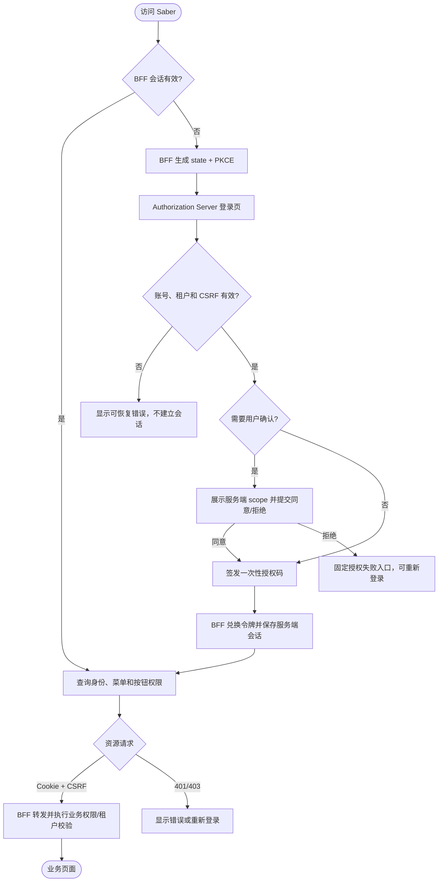

# Saber 新认证服务与 BFF 前端适配需求文档

## 1. 文档信息

| 项目 | 内容 |
| --- | --- |
| 需求名称 | Saber 新认证服务与 BFF 前端适配 |
| 需求编号 | REQ-2026-015 |
| 文档版本 | 0.13 |
| 所属模块 | 认证页面、会话状态、请求层、动态路由、权限初始化、OAuth 客户端管理 |
| 目标版本/迭代 | Saber 5.x / SpringBlade 新 OAuth2/OIDC 与 BFF 迁移第一阶段 |
| 文档状态 | 开发中（登录与确权界面改版，新增验收待执行；历史阶段结果保留） |
| 产品负责人 / 技术负责人 | 待指定 / 待指定 |
| 创建日期 / 最后更新日期 | 2026-10-10 / 2026-10-15 |
| 关联事项 | [需求索引](../requirements-index.md)；前端 POC [运行说明](../authorization-poc.md)；后端 [SpringBlade REQ-2026-010](../../../SpringBlade/doc/requirements/REQ-2026-010-production-authentication.md)；后端 [DESIGN-REQ-2026-010](../../../SpringBlade/doc/design/DESIGN-REQ-2026-010-production-authentication.md) |
| 数据库设计 | Saber 不涉及；认证、授权状态、客户端和会话由 SpringBlade REQ-2026-010 承接 |
| 详细设计 / 测试文档 | [详细设计0.11](../design/DESIGN-REQ-2026-015-authorization-frontend-adaptation.md)；[测试文档0.9](../test/TEST-REQ-2026-015-authorization-frontend-adaptation.md)：登录与确权改版的新增用例待执行，历史阶段证据保留 |

本需求承接当前 Saber 认证页面与 BFF 验证 POC，目标是将验证链路扩展为可承载现有业务页面的前端认证链路。
后端协议、用户认证、客户端注册、资源服务和 BFF 业务路由以 SpringBlade REQ-2026-010 及其后续确认结果为准。
用户于2026-10-13授权进入实现，当前工作区已完成前端适配；2026-10-14授权修复测试脚本并重跑，定向自动化67通过/1角色契约失败，完整业务验收和发布环境验证尚未完成，不标记已验收。

随后用户授权修复管理员角色契约，并明确要求修复后暂不复测。0.9已按后端允许的 `administrator`/`admin` 修正判断，测试脚本及文档同步，等待下一次测试通知；历史执行结果保持不变。

用户随后通知开始测试。0.10按当前脚本完成首轮86次执行：85通过、1首次导航超时；原样诊断复跑该用例通过。角色修复已取真实证据并关闭DEF-015-001，首次导航不稳定登记DEF-015-002，完整验收仍未完成。

0.11按用户要求定向重测登录跳转。排除前端连接环境阻塞后，保持现有5秒断言连续5次通过；历史超时本轮未复现，根因未确定，DEF-015-002保留待观察，不修改业务或测试源码、不标记已验收。

0.12结合用户认可验收的意见复核既有报告，现有86个自动化执行项均已有通过证据，本轮自动化覆盖范围阶段性验收通过；历史导航超时保留为非阻断观察。12个完整业务用例剩余步骤和32项标准的整体验收继续待完成，需求总体保持开发中。

实施前评估基线为 2026-10-13 的 SpringBlade 需求 0.13、详细设计 0.12、数据库设计 0.9、测试文档 0.13，以及两仓库当前工作区。
当时后端测试文档统计为31项：4 通过、0 失败、20 阻塞、1 不适用、6 未执行；历史重启后执行仍为 25 项中 4 通过、21 阻塞。范围调整及新增用例不等于新实现已验证。该评估阶段只核对文档与源码，当前实现记录见第12节。

## 2. 摘要与目标

### 2.1 摘要

SpringBlade 后端采用 OAuth2/OIDC 授权码 + PKCE 与 BFF 会话模式。Saber 直接以新认证系统作为唯一认证入口，
使用 HttpOnly 会话 Cookie 访问 BFF，由服务端保存和刷新 OAuth 令牌；浏览器继续使用现有菜单、角色、按钮和租户业务能力，
但不再保存、拼接或展示 Access Token、Refresh Token、BFF/服务客户端密钥或旧 Basic 凭据。
管理员维护 OAuth 客户端时可在受控表单中短暂输入新原始密钥并提交保存；该值不回显、不持久化、不作为浏览器认证凭据。

### 2.2 需求目标

1. 建立统一的 `/auth/login`、`/auth/consent`、回调验证和会话失效处理，支持登录、授权确认、重试和退出。
2. 将业务请求、菜单、用户信息、权限、上传下载和写操作迁移到 BFF Cookie + CSRF 契约。
3. 保持现有动态菜单、角色按钮、租户数据权限和业务页面行为，由后端认证上下文适配桥承接身份。
4. 移除旧 `blade-auth`、`Blade-Auth`、浏览器 Token 和旧登录入口，确保前端只连接新认证系统，不维护双链路状态。
5. 使 OAuth 客户端管理页面符合新的 grant、scope、audience、PKCE、TTL、停用和密钥写入规则。

### 2.3 非目标

- 不在 Saber 中实现 Authorization Server、用户密码校验、Token 签发、Refresh Token 轮换、JWT 验签或数据库迁移。
- 不重新设计角色、菜单、按钮权限、数据权限和租户模型；这些能力继续由现有业务服务提供。
- 不在本需求引入社交登录、短信/邮件 MFA、SAML、设备授权、在线密钥轮换、多实例 HA 或完整 OIDC 全局单点退出；旧认证体系中的同类入口直接移除。
- 不建设审计表、审计接口或脱敏流程，只遵守不记录或泄露敏感信息的安全底线。
- 不让浏览器直接调用 `/oauth2/token`、`/oauth2/introspect`、`/oauth2/revoke` 或保存 OAuth 令牌。
- 不把 demo 验证接口当作业务资源交付；demo 仅用于联调和验收样例。
- 不把前端隐藏按钮当作安全边界；所有权限和租户校验仍由后端执行。

## 3. 用户故事与范围

### 3.1 用户故事

| 故事编号 | 优先级 | 用户故事 | 典型场景 | 依赖 |
| --- | --- | --- | --- | --- |
| US-001 | Must | 作为最终用户，我希望通过统一认证页面登录并进入 Saber，以便访问已有业务菜单 | 直接访问业务页面或从 BFF 发起登录 | Authorization Server、BFF、有效用户和租户 |
| US-002 | Must | 作为已登录用户，我希望看到当前用户、菜单和按钮权限，以便继续使用原有管理功能 | 登录回调后加载首页、动态路由和权限 | BFF 身份上下文、system 菜单接口 |
| US-003 | Must | 作为用户，我希望会话过期或退出后得到可恢复提示，以便重新登录 | 401、BFF 重启、主动退出 | BFF 会话和 CSRF |
| US-004 | Must | 作为管理员，我希望维护符合 OAuth2/OIDC 规则的客户端配置，以便管理 BFF 和服务调用方 | 应用管理页面新增、编辑、停用、删除客户端 | system 客户端管理接口、管理员权限 |
| US-005 | Should | 作为运维人员，我希望新认证系统的入口、Cookie 和代理配置明确，以便稳定发布和定位认证故障 | 新认证系统上线、故障提示和重新登录 | BFF、Authorization Server、反向代理 |

### 3.2 范围内

- 新认证页面：`/auth/login`、`/auth/register`、`/auth/consent`、`/auth/verify` 及授权错误、CSRF 失败、重复回调和会话过期状态。
- BFF 会话初始化、用户信息恢复、动态菜单/按钮权限加载、路由守卫和未登录跳转。
- Axios 请求层改为 Cookie 会话；写请求按后端契约携带 CSRF；统一处理 401、403、429、5xx 和业务错误。
- 退出当前 BFF 会话、清理本地 UI 状态、标签页和临时表单数据。
- 现有业务 API、菜单、用户信息、文件上传下载和外链入口的认证适配。
- OAuth 客户端管理页面的客户端名称、认证方式、授权类型、scope、audience、回调地址、令牌 TTL、PKCE、同意和状态字段。
- 开发代理、生产反向代理、Cookie/CSRF 配置和新认证系统上线说明。
- 与 SpringBlade REQ-2026-010 的前端验收矩阵和联调依赖记录。

### 3.3 范围外

后端认证服务、BFF 业务路由、身份上下文适配桥、资源服务 JWT 校验、Redis/MySQL、JWK 密钥和客户端数据迁移由 SpringBlade REQ-2026-010
及其设计承接。本需求不把后端尚未确认的路由、字段、错误码或权限配置写成已存在事实。

旧认证的验证码登录、社交/手机号登录、旧注册接口和旧认证入口移除。用户于 2026-10-13 明确保留新注册：`/auth/login` 展示开关控制的入口，`/auth/register` 通过 system 新接口注册，使用独立注册图形验证码和 BFF CSRF，成功后回新登录页，由用户主动 BFF 登录。注册不签发令牌，不复活旧 `/blade-auth/register`；后端业务规则由 [SpringBlade REQ-2026-003](../../../SpringBlade/doc/requirements/REQ-2026-003-user-registration.md)维护。

## 4. 业务流程

### 4.1 流程说明

前置条件：Authorization Server、BFF、system、Redis、必要资源服务和反向代理已部署；客户端已启用；回调地址、issuer、Cookie 和 CSRF
配置一致；用户和租户有效。

1. 用户访问 Saber 业务页面或 `/auth/verify`，前端查询 BFF 会话。
2. BFF 会话不存在时，前端跳转 `/oauth2/authorization/{registration}`，由 BFF 生成 state 和 PKCE。
3. Authorization Server 将用户引导至 Saber `/auth/login`；前端取得登录上下文和 CSRF 后提交账号、密码和租户。
4. 登录成功后恢复原授权请求；需要确认时展示服务端返回的客户端和 scope，用户同意或拒绝。
5. BFF 使用授权码兑换并在服务端保存 OAuth 令牌，浏览器只接收 BFF 会话 Cookie。
6. 前端查询 `/bff/me` 确认会话，再从 `/blade-system/user/info` 的资料及 `roles` 角色编码加载当前身份、菜单和按钮权限；完整初始化成功后装配动态路由并进入业务页面。`/bff/me` 仍只是摘要；后端角色字段及组装源码已有，实际 JSON View 输出与前端初始化需联调验收。
7. 业务读请求使用会话 Cookie；写请求使用会话 Cookie 和 CSRF；BFF 统一 TokenRelay 标准 Bearer，资源服务独立验签并通过 JWT 到 BladeUser 桥恢复身份。前端不选择传播模式，也不发送自定义身份头。
8. 用户退出或会话失效时，前端清理当前 UI 状态并回到新认证入口；不得把旧 Token 作为恢复手段。

### 4.2 业务流程图

### 4.3 异常与替代流程

| 编号 | 触发条件 | 系统行为 | 用户提示 | 数据是否改变 |
| --- | --- | --- | --- | :---: |
| EX-001 | 未登录或 BFF 会话不存在 | 返回 401；清理当前前端会话并保留安全的回跳位置 | 请先登录 | 否 |
| EX-002 | 错误密码、禁用用户或租户 | 不建立授权会话，不回显内部原因 | 账号或密码错误，或账号暂不可用 | 否 |
| EX-003 | state、PKCE、回调或授权码无效 | 拒绝并回到固定认证页面，不回显 code/state | 授权请求无效，请重新登录 | 否 |
| EX-004 | scope 不足或业务权限不足 | 返回 403；保留当前会话和输入上下文 | 权限不足 | 否 |
| EX-005 | CSRF 缺失或错误 | 拒绝写请求，保留会话 | 页面校验已失效，请重试 | 否 |
| EX-006 | BFF 刷新失败或会话被撤销 | 后端拒绝并清理会话；前端收到 401 后清理 UI，禁止继续提交；不按前端到期计时推断撤销 | 登录已失效，请重新登录 | 业务数据不变，认证状态可能失效 |
| EX-007 | 认证依赖超时或服务不可用 | 不把失败转换为已登录或空权限，允许局部重试 | 认证服务暂时不可用 | 否 |
| EX-008 | OAuth 客户端密钥留空编辑 | 前端省略密钥字段；服务端保留原密钥 | 配置已更新 | 是，其他字段 |

## 5. 功能需求与验收标准

### 5.1 REQ-001 认证入口与登录上下文

- 前置条件：用户访问 `/auth/login`，Authorization Server 能返回登录上下文和 CSRF 参数。
- 处理规则：登录页从服务端读取默认租户和待恢复授权状态；密码只通过表单提交，不写入路由、日志、Pinia 或持久化存储。
- 输出：登录成功恢复原授权流程；失败保留可重试页面和通用错误提示。

验收标准：

- `AC-001`：Given 未登录用户访问 BFF 保护资源，When 发起登录，Then 浏览器进入 `/auth/login`，授权请求包含服务端生成的 state 和 S256 PKCE。
- `AC-002`：Given 登录上下文加载成功，When 用户提交合法租户、账号、密码和 CSRF，Then 原生表单提交到认证服务，浏览器不发送 Basic、`Blade-Auth` 或 OAuth Token。
- `AC-003`：Given 密码错误、用户停用、租户停用或认证依赖不可用，When 提交登录，Then 不建立 BFF 会话，页面显示可区分但不泄露内部细节的错误，并允许重试。
- `AC-004`：Given 登录页面被刷新、后退或重复打开，When 页面重新加载，Then 密码输入清空，CSRF 和待授权上下文重新获取，不重复提交上次表单。

### 5.2 REQ-002 授权确认与回调

- 前置条件：认证服务已确认当前用户、客户端、state 和待授权 scope。
- 处理规则：展示内容以服务端 `/ui/consent` 返回为准，不信任 URL 中的 scope。当前后端 ConsentContext.csrf 已提供 parameterName/headerName/token，POST authorize 已显式检查 AUTH CSRF；前端 approve/deny 均须补入该参数，不能使用 BFF CSRF 替代。源码具备不代表缺失/错误 CSRF 与授权状态副作用已取得运行证据。
- 输出：同意后返回 BFF 回调；拒绝、过期或篡改后回到固定错误入口。

验收标准：

- `AC-005`：Given 有效待确认授权，When 打开 `/auth/consent`，Then 页面展示服务端返回的客户端名称、当前账号和 scope 描述，不展示未经服务端确认的 scope。
- `AC-006`：Given 用户点击同意或拒绝，When 提交授权决定，Then 请求只提交当前客户端、state、决定、服务端允许的 scope 和 CSRF，按钮在请求完成前不可重复提交。
- `AC-007`：Given state、client_id、回调地址、授权码或 verifier 被篡改或重复使用，When 继续授权，Then 不建立会话，页面不回显敏感参数且可重新发起登录。

### 5.3 REQ-003 BFF 会话与业务请求

- 前置条件：BFF 已建立 HttpOnly 会话；后端已提供用户信息、菜单、按钮权限和业务路由。
- 处理规则：浏览器业务请求只依赖 Cookie；服务端保存和刷新 OAuth 令牌；前端不实现 Token 刷新定时器。
- 输出：业务接口继续返回现有业务数据和权限语义；认证错误按 HTTP 状态和业务码统一处理。

验收标准：

- `AC-008`：Given BFF 会话有效，When 加载用户信息、菜单和按钮权限，Then 首页可进入，动态路由和 `useCrudPermission` 结果与服务端当前用户一致。
- `AC-009`：Given 浏览器访问普通业务接口，When 查看请求和响应，Then 认证凭据只有会话 Cookie，写请求另带 CSRF，无 Basic、Bearer、`Blade-Auth` 或自定义身份头；响应不包含 Access Token、Refresh Token、客户端密钥或内部堆栈。
- `AC-010`：Given BFF 会话过期、刷新失败或被撤销，When 访问业务接口，Then 当前会话被清理，页面跳转 `/auth/login` 或固定认证入口，不循环请求旧 Token。
- `AC-011`：Given scope 不足、按钮无权或租户越界，When 访问业务接口，Then 分别得到后端定义的 403/业务错误，页面不展示成功、不改变业务数据。

### 5.4 REQ-004 写请求、CSRF 与退出

- 前置条件：页面执行新增、修改、删除、上传、导入、修改密码或退出等有副作用的操作。
- 处理规则：前端按后端契约获取当前会话 CSRF，并在写请求中发送；CSRF 获取失败时禁止提交；退出只清理当前 BFF 会话。
- 输出：成功关闭或刷新页面状态；失败保留输入和可重试状态。

验收标准：

- `AC-012`：Given 写请求缺少、错误或过期 CSRF，When 提交操作，Then 服务端返回 403，页面不显示成功，当前会话和用户输入按操作类型保留。
- `AC-013`：Given 新增、修改、删除、上传或导入请求正在执行，When 用户重复点击，Then 只产生一次有效写请求，失败时释放执行锁且不伪造回滚结果。
- `AC-014`：Given 用户确认退出，When 提交正确 CSRF 的 `/bff/logout`，Then 当前 BFF 会话失效、本地用户态和临时页面状态清理，其他浏览器会话不受影响。
- `AC-015`：Given 退出请求失败或网络中断，When 页面收到结果不确定状态，Then 不宣称退出成功，显示可重试提示并允许重新检查会话。

### 5.5 REQ-005 新认证系统唯一链路与旧认证移除

- 前置条件：新 Authorization Server、BFF、反向代理和业务资源已按新契约部署。
- 处理规则：前端只保留新认证页面、Cookie、BFF 请求和代理路径；删除旧认证页面、旧 Token 存储、旧刷新逻辑、旧请求头、旧 API 和旧代理配置。
- 输出：应用启动和业务请求均只使用新认证系统；旧入口不会被前端重新引导或当作认证恢复手段。

验收标准：

- `AC-016`：Given 新链路已启用，When 检查前端构建产物、浏览器存储和普通业务 Network，Then 不包含 BFF/服务客户端密钥、Access Token、Refresh Token 或旧 Basic 凭据；管理员新密钥仅在显式保存的请求体中出现，不进入 URL、存储、响应或证据。
- `AC-017`：Given 用户访问旧前端登录或 `/blade-auth/*`、旧回调，When 新版本运行，Then 不提供旧页面、不发起旧请求、不保存旧 Token；旧服务路径停用或不存在。同源 `/login` 属于 SAS 原生表单端点，其 GET 可导航新 `/auth/login`，不承载旧 Saber 页面。
- `AC-018`：Given 用户刷新页面或重新打开业务入口，When 应用初始化，Then 只检查 BFF 会话并跳转新认证入口，不读取旧 Cookie、旧 Store 或旧 Token。

### 5.6 REQ-006 OAuth 客户端管理页面

- 前置条件：管理员拥有客户端管理菜单和动作权限，后端返回符合新协议的客户端字段。
- 处理规则：客户端标识创建后不可修改；认证方式只允许后端支持的类型；授权码客户端必须使用 PKCE 和精确回调；scope、audience、grant 和 TTL 仅提交白名单字段。
- 密钥规则：新增机密客户端必须填写原始密钥，至少 16 字符、最多 72 个 UTF-8 字节，不接受以 `{` 开头的摘要表示；详情和列表不返回密钥原值。已有合规密钥的机密客户端编辑留空表示保留，旧非合规密钥须显式替换；公共客户端不能设置密钥。当前为管理员自备新值后单值替换，无生成、一次展示、版本历史或双密钥过渡能力。
- 输出：保存、停用、删除和冲突结果以服务端响应为准，不把页面校验当作最终安全边界。

验收标准：

- `AC-019`：Given 管理员打开客户端表单，When 选择客户端认证方式，Then 页面不提供后端已禁止的 `client_secret_post`，公共客户端自动限制为授权码 + PKCE。
- `AC-020`：Given 编辑机密客户端且密钥输入为空，When 保存其他字段，Then 请求省略密钥字段，服务端原密钥保持不变；页面不把空字符串当作新密钥。
- `AC-021`：Given 新增或编辑客户端，When 输入重复 ID、通配回调、非法 scope/audience、无 PKCE 授权码或复用 Refresh Token 配置，Then 前端阻止明显非法输入，后端拒绝结果保留表单并恢复提交状态。
- `AC-022`：Given 客户端被停用，When 再次发起授权或令牌请求，Then 新请求被拒绝；已签发 JWT 可能在 exp 前仍有效，前端按实际响应处理，不宣称全部会话立即退出；后续 401 按稳定会话码或单飞会话探测处理，不能把资源拒绝直接当注销。

### 5.7 REQ-007 全站初始化与迁移闭环

- 前置条件：BFF 的七类业务路由已登记，当前用户资料和角色编码契约可供前端消费。
- 处理规则：按会话、用户资料/角色、菜单/按钮、动态路由顺序初始化；不读取持久化的旧用户/菜单/权限作为已登录依据。管理员UI统一通过 `isAdmin` 精确识别后端 `RoleConstant.HAS_ROLE_ADMIN` 允许的 `administrator` 或 `admin`；原始 `role_alias` 不改名，按钮权限单独校验，不能从 scope、角色显示名称或角色 ID 推导管理员身份。
- 输出：初始化失败可重试；退出、确认BFF会话失效和身份变化时清理动态路由及权限缓存，迟到响应不得恢复旧上下文。

验收标准：

- `AC-023`：Given 有效 BFF 会话，When 刷新受保护页面，Then 先确认会话，再从已登记路径恢复用户、租户、角色编码及菜单/按钮，不请求旧 `/user/getUserInfo`，不解析浏览器 Token，不以 `/bff/me` 的 scope 生成按钮权限。
- `AC-024`：Given 用户、角色或菜单/按钮任一加载失败，或请求期间退出/身份变化，When 初始化或旧响应完成，Then 不进入依赖未就绪权限的业务页，不使用上次权限或把失败当作成功空权限；可重试且动态路由不残留旧身份菜单。
- `AC-025`：Given CSRF 校验失败与 scope/业务权限不足均返回 403，When 前端处理错误，Then 不清理有效会话、不自动重放写请求；只有明确识别 CSRF 错误后才重新获取 CSRF 并由用户再次提交，无法区分时显示通用拒绝提示。
- `AC-026`：Given 用户上传头像、导入用户或导出文件，When 操作请求发出，Then 使用统一同源 Cookie/CSRF 请求能力，无旧 Token 上传头或 URL 凭据；失败保留可重试状态且不显示成功。

### 5.8 REQ-008 凭据操作与退出边界

- 前置条件：当前用户可能已经由真实密码登录迁移为 BCrypt，密码操作和本地锁屏仍为已有业务能力。
- 处理规则：保留用户管理与个人资料能力；改密使用已明确的 JSON oldPassword/newPassword/confirmPassword，后端兼容真实旧密码与 BCrypt 并统一编码新密码，不新增全局会话撤销。前端不得沿用密码 query 或旧字段 newPassword1，管理/导入/重置流程仍需实际回归。锁屏是本地 UI 功能，不代表重新认证，退出仍使用 BFF。
- 输出：相关流程纳入全站回归；后端未满足时保留阻塞，不用旧认证 API 恢复。

验收标准：

- `AC-027`：Given 用户密码已迁移为 BCrypt，When 从个人信息修改密码或由管理员重置后重新登录，Then 操作按后端确认的凭据契约完成，旧/新密码校验及会话行为有证据，密码只在请求体中短暂提交；契约不满足时该验收保持阻塞。
- `AC-028`：Given 管理员编辑机密客户端，When 留空保存或显式提交新密钥，Then 合规旧密钥保留或新值单次替换，页面关闭/成功/离开后清空输入，原值不回显；并发覆盖和结果不确定时不宣称回滚，要求重新查询。
- `AC-029`：Given 用户退出当前 BFF 会话，When 再次发起登录，Then 认证服务会话可能仍有效并免密码，页面不宣称全局退出或强制重新输入密码；另一 BFF 会话不受影响。
- `AC-030`：Given 本地 UI 已锁屏但 BFF 会话失效，When 尝试解锁或退出，Then 会话检查优先于本地解锁，失效后进入新认证入口，不调用旧登录或退出 API；锁屏密码不作为 OAuth 凭据或持久化认证依据。

### 5.9 REQ-009 新注册入口与登录闭环

- 优先级：Must
- 处理规则：从 `/auth/login` 按开关进入 `/auth/register`，读取 system 最小配置/验证码；真实密码、确认密码只在表单与 JSON Body 短暂存在，字符规则与最多72 UTF-8字节均校验。POST 携 BFF CSRF，不携 Token；普通角色、有效租户、账号唯一和事务由 system 决定。成功清理密码/验证码，返回新登录页；用户主动登录，不自动签发令牌。失败保留可复用非敏感输入，需新验证码，不自动重放。

- `AC-031`：Given 注册开启且有效租户/普通角色，When 从 Saber 新入口提交合法注册，Then 调用 system 新接口保存 BCrypt 普通用户，成功回新登录页，不自动登录；用户主动 BFF 登录后加载普通角色/菜单。
- `AC-032`：Given 注册关闭、输入/验证码/限流/租户/角色/重复/依赖或CSRF失败，When 进入页面或提交，Then 按契约拒绝且无部分用户、不获得管理权限；新验证码手动重试，密码不出现在URL/Storage/响应/证据，旧注册路径不调用。

### 5.10 REQ-010 面向用户的登录与确权界面

用户确认采用品牌分栏登录页与独立确权卡片。正常流程收敛为登录、按服务端要求确认授权、自动进入原业务页面；登录状态与页面安全校验由系统内部处理。Saber 不涉及数据库变化，本轮不改变后端 scope、角色、租户、AUTH/BFF 会话或原生表单契约。

- `AC-033`：登录页采用品牌分栏，确权与进入系统采用独立卡片；中文、英文、日文提示随语言切换，浅色、深色、自定义主色及1440px、1024px、375px主要操作可达。
- `AC-034`：普通用户直接打开登录页时自动准备授权请求；已有有效BFF会话时自动进入业务。短时间内无效上下文重复返回时停止自动跳转并提供重新登录；注册成功返回仍由用户主动登录，密码不持久化。
- `AC-035`：确权卡片突出服务端账号、应用与全部申请权限，不把编码作为主要文案；缺用途说明的权限明确提示并可查看标识。同意前重新确认主体、应用及scope，任一展示内容变化时要求再次确认，不擅自增减授权范围。
- `AC-036`：回调页自动恢复会话、菜单、按钮权限和安全校验，成功返回安全业务地址；进行中不显示诊断按钮。失败按未登录、授权未完成或服务不可用提供重新登录/重试，不把未知回调失败宣称为用户取消。
- `AC-037`：用户菜单移除检查登录状态。403保留会话和可复用输入、不自动重放操作；内部使BFF校验缓存失效，下一次用户主动提交先取新值，未取得校验信息不得发送业务写请求。
- `AC-038`：用户菜单与锁屏退出成功后停留在已退出页面，不自动重新发起SSO；用户主动点击重新登录后才开始新授权。退出失败不宣称成功，不承诺全局退出或切换账号。

## 6. 业务规则与状态

### 6.1 业务规则

| 规则编号 | 规则 | 适用范围 | 违反时行为 |
| --- | --- | --- | --- |
| BR-001 | 浏览器不保存或主动刷新 OAuth Access Token、Refresh Token | 全部认证和业务页面 | 阻止请求并记录可定位的非敏感错误 |
| BR-002 | 浏览器业务请求使用 BFF Cookie；写请求使用后端定义的 CSRF 机制 | 业务 API、上传、退出 | 无 CSRF 时禁止提交 |
| BR-003 | OAuth scope 控制协议资源，角色/菜单/按钮和数据权限继续由业务服务执行 | 菜单、业务 API | 不用 scope 或 JWT 角色替代业务权限 |
| BR-004 | 登录租户由服务端校验；客户端提交的租户字段不能覆盖已建立会话的租户上下文 | 登录、刷新、同意和业务请求 | 服务端拒绝越租户操作 |
| BR-005 | 认证错误、权限错误和依赖错误必须可区分且不泄露密码、Token、密钥、SQL 或堆栈 | 页面、响应、日志和缓存 | 使用通用提示和状态码 |
| BR-006 | 客户端 ID 创建后不可修改；客户端密钥只写入或替换，不回显原值 | 客户端管理 | 拒绝不可变字段修改或密钥泄露 |
| BR-007 | Saber 只支持新认证系统，旧认证体系不作为兼容或恢复路径 | 全部认证入口和业务请求 | 删除旧入口和旧状态，不自动回退 |
| BR-008 | 网关到下游仅用标准 Bearer + JWT 到 BladeUser 桥；浏览器不发送 Bearer 或身份头 | 全部业务路由 | 不恢复 IDENTITY 或旧 HMAC 模式 |
| BR-009 | scope/audience 配置只约束资源访问，不作为用户角色或前端管理员身份 | 权限初始化、客户端管理 | 缺少角色编码时禁用依赖该身份的入口 |
| BR-010 | 客户端停用、撤销和当前会话退出不保证已签发 JWT 在 exp 前立即失效 | 客户端管理、退出提示 | 按后端实际状态处理，不承诺全局失效 |

### 6.2 状态与迁移

| 状态 | 含义 | 允许操作 | 可迁移到 |
| --- | --- | --- | --- |
| SESSION_ABSENT | 没有可用 BFF 会话 | 发起登录、查看公开认证页 | SESSION_ACTIVE |
| SESSION_ACTIVE | BFF 会话和用户上下文有效 | 访问、写入、退出 | SESSION_EXPIRED / SESSION_REVOKED |
| SESSION_EXPIRED | 后端确认会话失效或刷新不可用；Access Token 到期可能由 BFF 正常刷新 | 重新登录、清理页面状态 | SESSION_ACTIVE |
| SESSION_REVOKED | 用户、租户、客户端或安全策略使会话失效 | 重新登录 | SESSION_ACTIVE |
| CLIENT_ACTIVE | 客户端可参与协议请求 | 查看、编辑、停用、删除 | CLIENT_DISABLED / CLIENT_DELETED |
| CLIENT_DISABLED | 客户端不接受新的协议请求 | 查看、恢复或删除（以服务端规则为准） | CLIENT_ACTIVE / CLIENT_DELETED |
| CLIENT_DELETED | 客户端逻辑删除 | 仅保留必要历史 | 不恢复或按后端策略处理 |

## 7. 认证与访问边界

### 7.1 资源归属

| 资源 | 归属类型 | 归属字段 | 字段来源 | 说明 |
| --- | --- | --- | --- | --- |
| BFF 会话 | 用户/浏览器会话级 | Cookie 会话 ID | BFF 服务端 | 浏览器不能读取服务端令牌 |
| 用户与菜单 | 用户/租户级 | userId、tenantId | system 与认证上下文适配桥 | 前端只消费服务端结果 |
| OAuth 客户端 | 实例级 | clientId | system 客户端管理 | 不因当前登录用户切换归属 |
| 业务资源 | 既有租户规则 | 现有 tenantId | 业务服务上下文 | 继续由后端校验最终归属 |

### 7.2 当前访问规则

| 操作 | 是否需要登录 | 业务前置条件 | 失败行为 |
| --- | :---: | --- | --- |
| 登录、认证上下文、OIDC discovery | 否 | 代理、issuer 和认证服务可用 | 认证错误或依赖错误 |
| 授权确认 | 是 | 当前用户与 state、clientId 匹配 | 400/401/403，不建立会话 |
| BFF 会话、用户信息、菜单和业务 API | 是 | BFF 会话有效，资源服务可用 | 401/403 |
| BFF 写请求和退出 | 是 | BFF 会话 + 正确 CSRF | 403 或统一业务错误 |
| OAuth 客户端管理 | 是 | 管理员菜单、按钮和后端权限有效 | 401/403/业务错误 |

### 7.3 后续权限影响

继续使用现有菜单、按钮和 API 权限编码；OAuth scope 仅作为协议资源边界，不新增前端角色模型。
客户端管理沿用 `client_view`、`client_add`、`client_edit`、`client_delete` 等现有权限约定，最终权限由后端校验。

## 8. 页面与交互要求

### 8.1 页面与操作

| 页面/入口 | 用户目标 | 主要操作 | 可见角色 | 原型 |
| --- | --- | --- | --- | --- |
| `/auth/login` | 输入账号、密码和租户 | 登录、新注册入口、重试 | 未登录用户 | 已实现，待真实验收 |
| `/auth/register` | 新注册并回登录 | 规则/验证码/CSRF/JSON提交 | 未登录且注册开启 | 已实现，待真实验收 |
| `/auth/consent` | 查看客户端和授权范围 | 同意、拒绝、重试 | 已认证用户 | 当前 POC 页面 |
| `/auth/verify` | 确认会话并初始化业务 | 登录、重试、退出；就绪后消费安全回跳 | 所有访问者 | 已实现，替换原demo验证按钮 |
| Saber 业务首页 | 使用现有管理功能 | 菜单、查询、写操作、上传下载 | 已登录且有业务权限的用户 | 现有页面 |
| 系统管理 > 应用管理 | 维护 OAuth 客户端 | 查询、详情、新增、编辑、停用、删除 | 已授权管理员 | 现有页面，字段按新契约调整 |

### 8.2 页面状态

| 状态 | 展示与行为 |
| --- | --- |
| 认证上下文加载中 | 显示加载状态，禁止提交账号密码和授权决定 |
| 空或无效授权上下文 | 清空旧数据，提供重新发起登录入口，不展示 URL 中未经确认的 scope |
| 登录或授权失败 | 显示通用原因，保留可重试入口，清空密码和敏感临时字段 |
| 会话检查中 | 不重复发起用户信息、菜单和业务请求 |
| 未登录/会话失效 | 清理本地用户态，跳转新认证入口并保留安全回跳位置 |
| 权限不足 | 显示 403/业务提示，保留会话，不伪造菜单或成功结果 |
| 提交中 | 禁用同一操作，保持 header/footer 和主要操作可见 |
| 提交成功 | 按业务关闭、刷新或跳转；清理密码和密钥输入，CSRF 按所属会话生命周期管理 |
| 依赖失败 | 局部重试；不把空权限、空详情或未知会话当作有效结果 |

页面需覆盖浅色/深色主题、1440px、1024px 和 375px 视口；认证表单正文独立滚动，键盘可以提交、取消和关闭。

## 9. 质量要求与影响

### 9.1 非功能要求

| 类别 | 要求 | 验证标准 |
| --- | --- | --- |
| 安全 | 浏览器不保存或发送 OAuth Token、BFF/服务认证密钥、旧 Basic 凭据；管理员新密钥仅受控写入；认证上下文和会话/CSRF/退出响应 no-store | 构建产物、Storage、Network、响应头和日志检查；普通业务响应缓存按业务契约 |
| 正确性 | 认证页面、BFF 和业务 API 使用新系统路径和状态码；失败不伪造登录或权限 | 协议、错误和回归用例 |
| 可用性 | 401/403/CSRF/依赖故障可恢复，重复操作有锁，会话切换不污染页面 | 故障、重试、并发和多标签页用例 |
| 兼容性 | 保持 Vue 3、Pinia、Axios、Element Plus 和现有动态菜单结构 | 类型检查、生产构建和业务回归 |
| 响应式与可访问性 | 认证表单和危险操作在目标视口可达，焦点和键盘路径完整 | 1440px/1024px/375px 人工验收 |

### 9.2 数据与接口影响

| 影响项 | 是否涉及 | 需求层说明 | 关联设计 |
| --- | :---: | --- | --- |
| 前端认证页面、请求层、Store 和路由 | 是 | 消费新登录上下文、同意上下文、BFF 会话和 CSRF 契约 | [Saber 详细设计 0.5](../design/DESIGN-REQ-2026-015-authorization-frontend-adaptation.md) |
| 业务 API 请求头和错误语义 | 是 | 从旧 Token 头迁移为 Cookie/CSRF，保留现有业务响应 | [Saber 详细设计 0.5](../design/DESIGN-REQ-2026-015-authorization-frontend-adaptation.md) |
| OAuth 客户端管理 API | 是 | 消费新客户端字段和密钥写入语义 | [Saber 详细设计 0.5](../design/DESIGN-REQ-2026-015-authorization-frontend-adaptation.md)；后端 REQ-2026-010 |
| Saber 数据库或浏览器 Token 存储 | 否 | 不新增数据库；移除浏览器 Access/Refresh Token 存储 | 不涉及数据库设计 |
| 后端认证、会话、授权数据库 | 依赖 | 由 SpringBlade REQ-2026-010 负责，Saber 不声明其实现已就绪 | SpringBlade 需求与设计 |
| 配置和部署 | 是 | Vite 代理、生产反向代理、Cookie、HTTPS 和精确回调需同步；不保留旧认证切换开关 | [Saber 详细设计 0.5](../design/DESIGN-REQ-2026-015-authorization-frontend-adaptation.md) |

### 9.3 依赖、风险与开放问题

| 编号 | 类型 | 内容 | 负责人 | 截止日期 | 状态/结论 |
| --- | --- | --- | --- | --- | --- |
| ITEM-001 | 路由依赖 | 七类固定业务路由和仅标准 Bearer 传播已落地；逐服务、方法、文件与未登记路径回归未完成 | 后端/网关待指定 | 前端全量切换前 | 部分明确，仍开放 |
| ITEM-002 | 初始化依赖 | 用户/角色及全量权限初始化已实现；真实字符串ID、租户、roles视图和失败恢复待验收 | 后端/前端待指定 | 权限初始化交付前 | 前端已实现，待真实验收 |
| ITEM-003 | 安全问题 | 前端登录/同意均消费独立AUTH CSRF，业务写请求使用BFF CSRF；缺失/错误及副作用待验收 | 前端/安全待指定 | 授权页面联调前 | 前端已实现，待真实验收 |
| ITEM-004 | 部署问题 | 后端 ingress 精确代理和 prod Secure 校验已有；实际域名/证书/issuer/回调与前端发布配置待准备 | 运维/后端待指定 | 联调前 | 配置源码具备，待环境验收 |
| ITEM-005 | 清理依赖 | 旧页面/API/Token读写/刷新/认证配置已移除，旧键只清理不读取；浏览器存储及构建产物待正式验收 | 前端 | 实现前 | 前端已实现，待真实验收 |
| ITEM-006 | 客户端管理问题 | 前端白名单、完整校验、admin与按钮权限、密钥清理及操作锁已实现；真实CRUD/停用/并发待验收 | 后端/前端待指定 | 客户端验收前 | 前端已实现，待真实验收 |
| ITEM-007 | 文档问题 | POC 说明已同步最新后端与前端消费差距；后端外层代理已有，不应要求静态 Nginx 重复实现 | 前端 | 联调前 | 文档差异关闭，环境归 ITEM-004 |
| ITEM-008 | 密码调用方缺口 | 前端已使用JSON oldPassword/newPassword/confirmPassword及规则校验；真实改密、重置和导入待验收 | 前端/后端待指定 | 全站发布前 | 前端已实现，待真实验收 |
| ITEM-009 | 注册调用方缺口 | 新注册页面、开关、配置/验证码/JSON与BFF CSRF已实现；注册闭环待验收，配置差异见ITEM-012 | 前端/后端待指定 | 新认证上线前 | 前端已实现，待真实验收 |
| ITEM-010 | 回滚边界 | 新体系停流/向前修复已明确，首次隔离演练待执行 | 运维/前后端待指定 | 首次切换前 | 待隔离演练 |
| ITEM-011 | 并发与故障 | BFF 已有单实例按会话串行授权及 Redis 重读/保存；尚无同会话并发刷新运行证据，不代表多实例协调 | 后端/前端待指定 | 全站验收前 | 实现缺口转验收项，禁止前端刷新/重放补偿 |
| ITEM-012 | 注册配置契约差距 | 后端注册响应仍缺passwordMaxBytes；前端按当前PasswordPolicy强制72字节并兼容未来可选字段，后端字段差异保留 | 后端/前端待指定 | 新注册联调前 | 响应差异开放，字节校验已实现 |

## 10. 评审与变更

### 10.1 需求评审清单

- [x] 已登记需求编号并明确前端适配范围。
- [x] 已关联 SpringBlade 新认证需求、前端 POC 和现有业务认证入口。
- [x] 已明确浏览器不持有 OAuth Token、写请求使用 CSRF、业务权限继续由后端执行。
- [x] 已识别 BFF 业务路由、用户上下文、CSRF、部署和新认证系统唯一链路依赖。
- [x] 已确认不保留旧认证兼容、旧登录/旧注册调用/验证码登录/社交入口；保留新注册入口。
- [x] 已按后端0.13/设计0.12同步目标并区分源码事实，原0.11/0.10核对仍为历史依据；已核实标准传播、固定路由、会话摘要、BFF CSRF 和客户端基础契约。
- [x] 用户/角色编码、授权确认防护、密码操作、新注册与同源目标契约已明确；实现/环境与技术评审待完成。
- [x] 已建立详细设计与正式待执行测试文档，技术评审与真实验收仍待完成。
- [ ] 真实后端、Redis、MySQL、密钥和浏览器环境完成 P0 验收。

### 10.2 评审结论

| 评审领域 | 结论 | 评审人 | 日期 | 条件/备注 |
| --- | --- | --- | --- | --- |
| 产品范围 | 待评审 | 待指定 | 待评审 | 确认新认证系统唯一入口和旧功能删除范围 |
| 技术可行性 | 待评审 | 待指定 | 待评审 | 核对后契约可作为开发基线；前端消费、注册配置差距和环境联调仍待完成 |
| 测试可验收性 | 待评审 | 待指定 | 待评审 | 已有 12 项待执行用例，需准备目标前端、真实后端与隔离夹具 |

### 10.3 变更记录

| 日期 | 版本 | 变更内容 | 原因 | 影响范围 | 修改人 |
| --- | --- | --- | --- | --- | --- |
| 2026-10-10 | 0.1 | 根据新认证服务评估结果建立 Saber 前端适配需求，登记 BFF、会话、请求层、权限初始化、兼容迁移和客户端管理范围 | 用户要求开始编写需求文档 | 前端认证链路、业务请求、客户端管理、部署协同 | Codex |
| 2026-10-10 | 0.2 | 删除旧认证兼容、灰度和回滚范围，明确新认证系统唯一入口以及旧页面、Token、请求头、刷新和社交/验证码入口的移除要求 | 用户确认不兼容老旧认证体系，直接全面适配新系统 | 需求范围、验收标准、清理任务和发布配置 | Codex |
| 2026-10-12 | 0.3 | 关联前端详细设计草稿，补充设计文档入口和影响项映射；需求仍待评审，测试文档暂不创建 | 用户要求根据最新需求开始编写详细设计 | 文档链路和评审准备 | Codex |
| 2026-10-13 | 0.4 | 依据后端需求 0.11/设计 0.10 重评：取消双传播假设，明确会话摘要与用户/角色初始化、CSRF 差距、密码兼容、文件调用方、客户端单值密钥与退出实时性；保留已确认的前端唯一链路和注册移除范围 | 用户要求按最新后端认证授权需求重新评估 | 需求、设计、POC 说明和索引；未修改业务代码或执行业务测试 | Codex |
| 2026-10-13 | 0.5 | 用户确认保留新注册，同步roles、AUTH CSRF、完整代理、401探测不重放、JSON改密及停流向前修复；新增AC-031/032和测试文档 | 用户要求修复设计评审问题并确认页面范围 | 需求/设计/测试/索引；不改业务代码或执行测试 | Codex |
| 2026-10-13 | 0.6 | 重新核对后端 0.13/设计 0.12 及最新源码，确认角色/CSRF/JSON改密/401码/注册/单会话串行刷新/生产代理已有；将原契约缺口转为前端实施与真实验收项，保留注册字节上限响应差距 | 用户要求后端设计修改后再评估 | 文档、测试计划与索引；不改业务代码、不更新用例实际结果 | Codex |
| 2026-10-14 | 0.7 | 完成前端Cookie/CSRF、会话权限初始化、注册/改密/文件/退出、客户端及旧认证清理；同步工程检查和验收边界 | 用户授权开始实现 | 不改后端/数据库；正式业务用例未执行 | Codex |
| 2026-10-14 | 0.8 | 修复并执行现有自动化脚本，登记68次执行67通过/1角色契约失败及清理、证据和剩余验收范围 | 用户要求修复脚本后重新测试 | 只改测试基础设施和文档；业务代码与后端不变，需求仍开发中 | Codex |
| 2026-10-14 | 0.9 | 对照后端管理员常量修复isAdmin，保留原始角色别名；同步真实断言、普通角色回归及文档，缺陷待复测 | 用户授权修复后明确暂不复测 | 不修改后端/数据库；不启动服务或执行浏览器测试，历史结果不变 | Codex |
| 2026-10-14 | 0.10 | 执行86次定向复测，85通过/1首次导航超时；原样诊断复跑通过，关闭角色缺陷，记录等待/启动不稳定项及剩余正式验收 | 用户通知开始测试 | 本轮只执行并归档测试，17份关键源码/配置哈希无变化，需求保持开发中 | Codex |
| 2026-10-14 | 0.11 | 登录跳转原样定向5次通过，记录68～242毫秒URL断言等待；保留前端连接环境诊断及历史偶发超时，缺陷待观察 | 用户要求重测登录跳转超时 | 204份业务/测试/配置哈希无变化，正式验收范围未完成，需求保持开发中 | Codex |
| 2026-10-14 | 0.12 | 复核现有86个自动化执行项通过证据并结合用户认可归档阶段性验收，导航超时改为非阻断观察，完整业务验收继续待完成 | 用户认为当前验证已通过、认可验收 | 仅证据核对及文档同步，不新增业务结果，不改变验收标准或总体开发中状态 | Codex |
| 2026-10-15 | 0.13 | 按确认草图改版登录/确权与自动进入流程，移除用户状态检查，补齐主动重试和退出停留；增加AC-033～038 | 用户确认按两份界面改版 | 前端、现有脚本及关联设计/测试；数据库不涉及，新增验收待执行 | Codex |

## 11. 实施前评估结论（2026-10-13，历史记录）

结论：后端需求 0.13/设计 0.12 已具备前端开发所需的主要契约，当前后端源码也具备相应实现。上次的四项决策缺口已经明确；当前主要任务是 Saber 消费新契约及联调验收，不能继续把它们全部列为“等待后端设计”。需求仍待技术评审，不据静态核对宣称具备全站上线条件。

| 领域 | 原假设/差距 | 重新评估结论 | 处理位置 |
| --- | --- | --- | --- |
| 浏览器与下游认证 | 文档仍含 IDENTITY/TOKEN 双模式 | 浏览器 Cookie + CSRF；下游统一标准 Bearer，JWT 桥保留业务权限 | REQ-003、BR-008、设计 3/6 节 |
| 身份恢复 | 曾缺少角色编码来源 | UserVO.roles 与 UserWrapper.role_alias 组装已有；前端改从当前用户资料初始化，实际视图待验收 | REQ-007、ITEM-002 |
| 写请求与授权确认 | 原前端表单未携 CSRF | 后端 Consent.csrf 及前置校验已有；前端必须添加 AUTH 字段，BFF 写请求独立注入 | REQ-002/007、ITEM-003 |
| 密码与 401 | 前端仍用旧 params/清理行为 | JSON oldPassword/newPassword/confirmPassword、BCrypt 及 40101/40102 已具备；前端按来源处理且不重放原请求 | REQ-003/008、ITEM-008 |
| 客户端管理 | 字段和密钥语义仍被列为全部未知 | 用后端已实现规则收敛校验与白名单；不新增生成/版本接口，不承诺即时撤销 JWT | REQ-006/008、ITEM-006 |
| 全站调用方 | 仅改 Axios 被视为可覆盖全部页面 | 必须覆盖头像上传、导入导出、个人密码、锁屏退出、动态路由和缓存清理 | REQ-007/008、设计实施清单 |
| 发布与注册 | 前后端回滚、注册结论混用 | 保留新注册并调用system；全量新体系停流/向前修复，无旧认证恢复路线 | ITEM-004/009/010 |
| 并发与配置 | 仍写“无刷新串行锁”；注册配置字段不一致 | 单实例串行授权与 Redis 同步已有，真实并发待验收；passwordMaxBytes 响应字段仍需对齐 | ITEM-011/012 |

本轮只完成文档和静态源码核对，未执行类型检查、构建、浏览器或真实接口测试。建议先适配 AUTH CSRF 与 JSON 改密两个直接影响现有调用方的契约，再实施统一请求/会话/权限初始化、新注册及文件专项，最后完成全站与生产验收。后端其他安全、存储和发布验收由其关联需求承接，不以源码已有校验推断通过。

## 12. 前端实施交付（2026-10-14）

- 认证上下文、会话、注册和业务请求统一到`src/axios.ts`。业务写请求从`/bff/csrf`单飞获取掩码值；AUTH登录/同意使用独立原生表单参数。403保留会话/输入，不按消息猜CSRF原因，不自动重放；账户菜单新增用户主动“检查登录状态”及更新页面校验的入口。
- 冷启动仅查询BFF会话，再加载`user/info`中的字符串ID、租户及`roles`，随后读取顶部菜单、动态菜单和按钮。全部成功后统一提交；按会话代次隔离请求及Store，退出/确认失效/身份变化清理动态路由、标签、锁屏、CSRF及本地日志。缺失角色编码或ID不合约时阻止业务初始化。
- 新登录页按开关展示注册，注册使用system配置、独立验证码和JSON/CSRF；失败清理密码并换验证码，成功回新登录页，由用户主动登录。按当前PasswordPolicy强制72个UTF-8字节，兼容未来可选`passwordMaxBytes`；后端响应缺字段的差异仍为ITEM-012，不宣称已补齐后端。
- 个人改密使用JSON`oldPassword/newPassword/confirmPassword`及规则校验；头像复用Axios FormData，导入、导出及代码下载沿用统一请求。顶部/锁屏退出使用BFF，本地锁屏密码仅内存保存，解锁先检查会话。
- 客户端管理同时检查admin与按钮权限，使用字段白名单、空密钥省略、公共客户端与PKCE联动、完整ID/密钥/grant/scope/回调/TTL校验；密钥替换、停用和删除有确认及执行锁，关闭/离开清理密钥输入。停用不承诺旧JWT即时失效。
- 删除旧登录/社交/验证码/注册页面、第三方注册、Token读写和刷新mixin、Basic配置、SM2登录包装器及未登记日志上传。已知旧Cookie/Storage只清理不读取；旧Token外链阻断，菜单维护方须更新地址。AI配置的读取前提改为当前用户与按钮权限。
- Vite使用精确协议路径、AUTH方法白名单及未知协议404，`/api/`与BFF统一目标。生产由后端ingress承接同源代理，Saber静态Nginx不重复转发。最新后端参考需求0.15/设计0.14/DB0.10/测试0.15，本轮不修改后端，不涉及数据库。

工程检查：`pnpm run type-check`、`pnpm run build:prod`、活动引用扫描及`git diff --check`通过。构建有依赖纯函数注解、动态/静态导入及分包体积提示，未阻断产物生成。没有启动服务、操作浏览器、访问真实业务接口或改写正式结果，12个用例仍未执行，需求保持开发中。

用户手工验收：按关联测试覆盖登录/同意/注册/错误恢复、角色菜单按钮与租户、客户端CRUD/密钥/停用、JSON改密/重置、头像/导入导出/代码下载、退出/锁屏、并发与迟到响应，以及Console/Network、浅色/深色/自定义主色和1440px/1024px/375px。生产issuer、回调、Cookie、可信代理、全服务权限与停流演练仍需真实环境证据。

## 13. 测试脚本修复与定向回归（2026-10-14）

用户授权修复既有4份Playwright脚本并重新执行。当前脚本验证实际登录/同意提交、注册字段全集与72/73字节、48301/48303、失败恢复/不重放/单次提交、三个视口浅深色及真实退出后的服务端状态，按批次保存报告并保护凭据。
最终68次执行为67通过、1失败：66次Mock全部通过，真实退出/另一会话隔离/清理通过；TEST_ADMIN资料roles有1项但不含预期admin编码，账号与主体匹配，保留DEF-015-001失败。其后HttpOnly/旧Cookie/缓存检查已继续完成。
结果、诊断批次、环境限制及剩余范围见测试文档第9节；不将定向执行次数折算为32项验收完成。运行后端部署提交、角色别名/缓存及管理员契约仍需核对，普通账号/两租户/并发/文件/改密/客户端/HTTPS发布等完整流程尚未验收。需求保持开发中。

## 14. 管理员角色契约修复（2026-10-14，待复测）

已核对后端 `blade-core-tool 5.0.1` 的 `RoleConstant.HAS_ROLE_ADMIN = hasAnyRole('administrator', 'admin')`，初始化SQL的超级管理员 `role_alias` 为 `administrator`。原前端及测试只识别 `admin`，未覆盖后端另一合法管理员别名。
本轮仅调整集中式 `useUserStore().isAdmin` 为两种别名的精确匹配，保留 `UserVO.roles`、`authority` 和路由角色列表原值；应用管理、授权、导入导出等既有调用方复用该getter。按钮权限、租户及后端校验保持独立，不修改角色数据或后端接口。
真实测试按同一后端契约取证，另准备6个隔离Mock回归子场景验证合法管理员及普通/空/相似角色名的UI隔离。用户明确要求暂不复测，DEF-015-001标记已修复待复测；原67通过/1失败记录不覆盖，需求仍开发中。

## 15. 角色修复复测与首次导航稳定性（2026-10-14）

按最新测试通知运行全部当前自动化，首轮86次为85通过/1失败：三个视口下的84次Mock全部通过，其中6种角色隔离共18次通过；真实退出/会话隔离通过。首个真实用例在角色检查前因5秒登录URL断言超时而失败，记录DEF-015-002，不能推断为确定业务登录失败。
保持业务、测试源码、预期及等待时间不变原样诊断复跑首个真实用例通过，确认实际资料含administrator、不含admin，新的管理员判断成立；身份/菜单、Cookie、旧存储及用例会话清理通过，DEF-015-001关闭。首轮失败与复跑通过分别保留，不改写为首轮全通过。
证据和源码清单见测试文档第11节。首次跳转耗时及等待策略仍需定位，普通真实账号/两租户/失败与迟到响应、刷新并发、文件/改密/客户端完整CRUD及HTTPS发布等剩余正式步骤尚未完成，需求保持开发中。

## 16. 登录跳转定向复测（2026-10-14）

用户要求重测登录跳转超时。首次5次因前端与测试进程的运行环境边界无法连接首页，尚未执行登录跳转断言；该环境诊断报告保留。将测试前端在沙箱外重启并确认可访问后，使用原用例、5秒URL断言和独立会话连续执行5次，全部通过，断言等待68～242毫秒，未自动重试。
5次均验证合法登录、PKCE、身份/菜单/角色、Cookie/旧存储和用例会话清理；204份业务、测试及配置文件批内/跨批哈希无变化。历史BFF跳转超时本轮未复现，其根因仍未确定，DEF-015-002保留待观察，不将环境连接问题当作历史超时原因。
分批结果、耗时、清理与证据见测试文档第12节。本轮未重跑全量自动化或剩余正式业务用例，12个完整用例仍1阻塞/11未执行，需求保持开发中。

## 17. 本轮自动化阶段性验收（2026-10-14）

用户认可当前验证已通过并认为可以验收。复核既有报告和源码一致性后，本轮现有自动化覆盖范围阶段性验收通过：86个执行项均有通过记录，原导航超时项后续原样复跑及连续5次复测通过，管理员角色缺陷已关闭。
DEF-015-002保留历史和根因未确定，作为本轮非阻断观察项，不以缺少偶发超时根因阻断已通过子场景的阶段验收。全量首轮85通过/1失败、后续复跑和环境诊断分别保留，证据及具体范围见测试文档第13节。
本轮认可覆盖当前脚本实际执行的认证/注册前端隔离、角色/布局和真实正向登录/退出链路。完整用例的真实异常、权限/租户、并发刷新、文件/改密、客户端、真实注册及HTTPS发布等剩余步骤仍待执行；32项标准的总体业务验收未完成，需求保持开发中。

## 18. 登录与确权界面改版交付（2026-10-15）

按用户确认的品牌分栏登录与独立确权卡片完成前端改版；登录准备、完整权限初始化和安全校验自动完成，异常提供重试或重新登录。保留独立AUTH原生表单、服务端全部scope和BFF Cookie契约；权限展示内容变化时再次确认。用户菜单移除状态检查，403后下一次主动提交重新取BFF校验，不自动重放。账户与锁屏退出成功后停留已退出页，主动重新登录才发起新授权。

新增六项标准AC-033～038及四个完整用例TC-013～016，合计38项标准、16个完整用例；用例、覆盖矩阵和汇总一致。中文/英文/日文静态提示已同步，布局使用主题Token及响应式滚动约束。工程检查type-check、type-check:e2e、build:prod、活动依赖扫描和diff空白检查通过；构建的依赖注解、动态/静态导入及分包提示非阻断。

本轮不启动测试服务、操作浏览器、访问真实业务接口、修改后端或数据库，也不创建提交。新版业务用例全部待执行，历史阶段证据仅属于改版前版本。用户需在真实环境检查登录/同意与取消/失败恢复/退出、权限与两租户、注册/锁屏/文件回归、Console/Network、浅深色/自定义主色及三种视口。后端权限用途说明、默认demo范围、回调失败原因细分及切换账号能力继续按后端范围处理，需求保持开发中。
